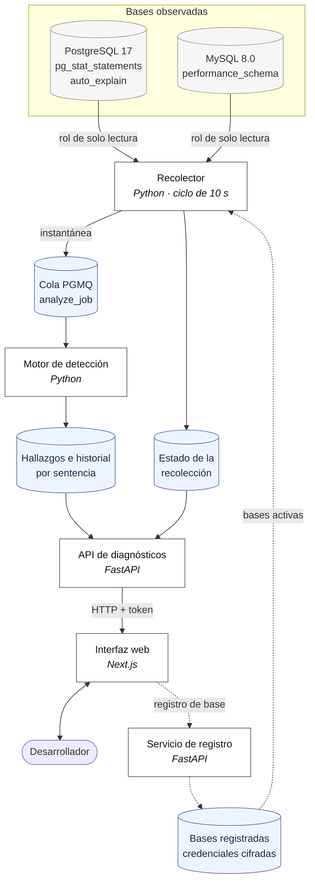
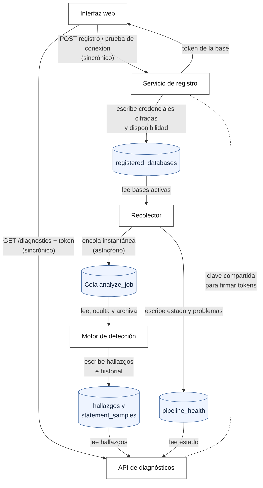
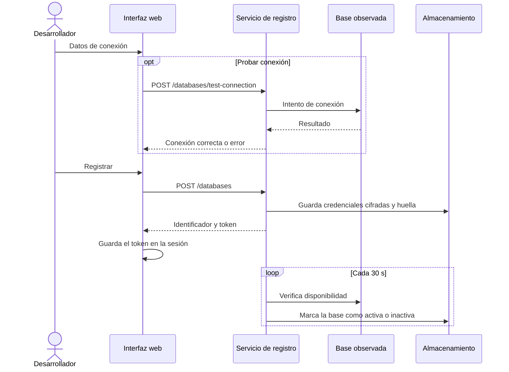
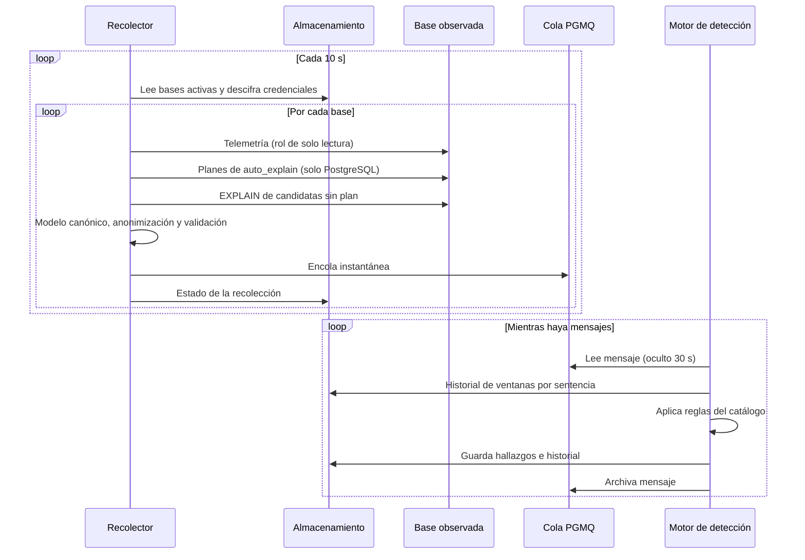
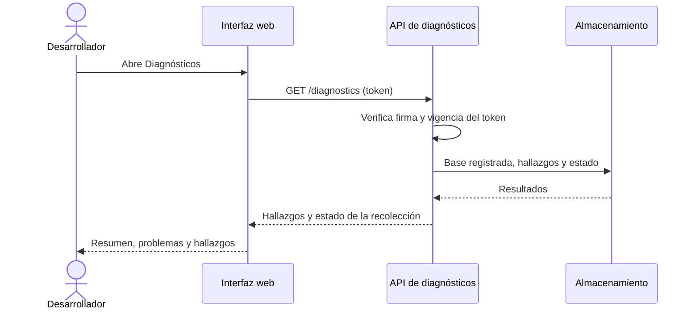

# Segundo Informe - querylens

## Resumen / Abstract

El diagnóstico de problemas de rendimiento y contención en bases de datos relacionales depende hoy de personal DBA especializado, un perfil minoritario frente al de los desarrolladores, o de herramientas comerciales de suscripción, algunas de las cuales señalan anomalías sin explicar su causa. Se propone QUERYLENS, una herramienta agnóstica de motor que recolecta telemetría de PostgreSQL 17 y MySQL 8.0 de forma no intrusiva, la normaliza a un modelo canónico común y detecta de manera determinista un catálogo cerrado de trece patologías (ocho anti-patrones de rendimiento y cinco patologías de contención, cuatro de ellas patrones de abrazo mortal), presentando cada hallazgo con evidencia, causa y recomendación accionable a través de una interfaz web. El alcance corresponde a un MVP funcional y documentado, de solo lectura y sin aprendizaje automático. El desarrollo sigue una metodología de ingeniería de diseño: definición de modelo canónico, evaluación de alternativas, implementación por componentes y validación en un banco de pruebas con inyección controlada de fallas.

Al cierre de este informe, la capa de recolección funciona en ambos motores sobre un ciclo de 10 s, entrega una instantánea validada contra un contrato a una cola de mensajes y registra el estado de cada recolección con un catálogo de problemas y acciones de remedio. Para obtener el plan de ejecución de cada consulta se evaluaron tres alternativas y se adoptó la lectura de los planes que registra auto_explain en PostgreSQL y de la muestra de cada sentencia agrupada en MySQL. Los ocho detectores de anti-patrones están implementados, tres de ellos integrados en el flujo de detección, y existen el servicio de registro de bases, la API de diagnósticos y una primera versión de la interfaz web. El módulo de análisis de contención aún no se ha implementado.

Las validaciones realizadas muestran que el sobrecosto del recolector sobre la latencia p95 de la carga queda por debajo del 5 % en ambos motores, con el límite superior de su intervalo de confianza del 95 % bajo ese umbral, y que ningún literal marcador inyectado aparece en el almacenamiento de QUERYLENS. La fuente de planes elegida coincidió con el plan real en 18 de 18 consultas con datos sesgados en cada motor, frente a 9 de 18 del plan genérico en PostgreSQL, y la suite automatizada de la capa de recolección aprueba sus 906 pruebas. Quedan pendientes, hacia la entrega final, la recolección de los informes de abrazo mortal, el módulo de contención, la integración de los cinco detectores que dependen del plan, la priorización por impacto y la campaña de validación que mide la precisión y la exhaustividad de la detección.

## 1. Introducción

Las bases de datos relacionales constituyen el componente central de la mayoría de las aplicaciones empresariales, desde sistemas transaccionales hasta plataformas de comercio electrónico y servicios financieros, cuyo funcionamiento depende de que las consultas se resuelvan en tiempos predecibles y de que las transacciones concurrentes no interfieran entre sí. En el sector de las tecnologías de la información, la adopción masiva de arquitecturas de microservicios, frameworks de mapeo objeto-relacional (ORM) y el crecimiento sostenido del volumen de datos han convertido el rendimiento de la capa de persistencia en un factor determinante tanto de la experiencia del usuario final como de los costos de infraestructura. En paralelo, la observabilidad de software se ha consolidado como práctica estándar de ingeniería, aunque su aplicación específica a bases de datos (donde la telemetría es heterogénea entre motores y su interpretación exige conocimiento especializado) sigue siendo un área con herramientas fragmentadas y de difícil acceso para equipos sin un administrador de bases de datos dedicado.

En la práctica actual, el diagnóstico de degradaciones de rendimiento depende de que alguien con experiencia interprete planes de ejecución y vistas internas cuyo nombre, formato y semántica cambian de un motor a otro. Ese perfil es minoritario: en la encuesta de desarrolladores de Stack Overflow de 2025, solo el 0,4 % de 43 560 encuestados se identificó como administrador o ingeniero de bases de datos, frente al 27 % que se declaró desarrollador *full-stack* y al 14,2 % que se declaró desarrollador *back-end* [26]; en Estados Unidos, la ocupación sumaba 144 500 empleos en 2025, con un crecimiento proyectado del 4 % hasta 2035 [27]. El diagnóstico es costoso incluso para los especialistas: en la base de datos OLTP de Alibaba, los DBA deben revisar cientos de indicadores para encontrar los síntomas de un problema, y diagnosticar manualmente la causa de una consulta lenta intermitente toma decenas de minutos, con decenas de miles de estas consultas al día [29].

Como consecuencia, problemas recurrentes (consultas sin índice adecuado, patrones ineficientes generados por el ORM o transacciones que se bloquean mutuamente) tienden a resolverse de forma reactiva y superficial, por ejemplo reintentando una transacción fallida en lugar de corregir su causa estructural en el código, o a permanecer sin corregir. Un estudio de 12 aplicaciones web reales construidas con mapeadores objeto-relacionales identificó 9 anti-patrones de rendimiento a partir de más de 200 incidencias; sus autores corrigieron 64 de ellas en las versiones más recientes de esas aplicaciones y obtuvieron una aceleración mediana de 2× y máxima de 39×, en la mayoría de los casos con menos de cinco líneas de código [28]. Las soluciones comerciales que automatizan este diagnóstico existen, pero se comercializan por suscripción por servidor, como los US$149 mensuales por servidor del plan de producción de pganalyze [30], o mediante cotización [21], lo que puede limitar su acceso para equipos pequeños. Además, no todas explican el razonamiento detrás de sus alertas: la detección de anomalías de SolarWinds Database Performance Analyzer usa un modelo de aprendizaje automático que predice el tiempo de espera esperado y señala las horas en que el real lo supera, sin identificar su causa [32].

Esta situación revela una necesidad técnica concreta: una herramienta que traduzca la telemetría heterogénea de distintos motores a un modelo de análisis común, que aplique reglas de detección deterministas y auditables en lugar de modelos que señalan anomalías sin explicar su causa, y que comunique sus hallazgos en un lenguaje accesible para un desarrollador sin formación especializada en administración de bases de datos. Esta necesidad constituye a su vez una oportunidad de diseño de ingeniería completa, que exige resolver la recolección no intrusiva de datos en un sistema en producción, la normalización semántica entre motores con modelos internos distintos, la anonimización de información sensible en el origen y el diseño de una capa de explicación que traduzca evidencia técnica en recomendaciones accionables.

Frente a esta oportunidad se propone QUERYLENS, una herramienta agnóstica de motor que observa bases de datos PostgreSQL y MySQL en operación sin instalar agentes dentro del motor, detecta de forma automática y determinista un catálogo de anti-patrones de rendimiento y patologías de contención (incluyendo el análisis estructural de abrazos mortales mediante la reconstrucción de su grafo de espera) y presenta cada hallazgo con evidencia, explicación y recomendación de acción. Se espera que esta herramienta reduzca el tiempo de diagnóstico de incidentes de rendimiento en equipos sin un especialista dedicado en bases de datos, sirviendo además como base extensible para incorporar motores adicionales en el futuro. Las secciones siguientes presentan el marco conceptual que sustenta la propuesta y detallan el planteamiento del problema, el alcance específico del proyecto, la metodología de desarrollo y el plan de trabajo propuesto para su ejecución.

En cuanto al estado actual del trabajo, el proyecto ya cuenta con una capa de recolección operativa en ambos motores, validada en su sobrecosto y en la anonimización de los literales, y con una decisión fundamentada sobre la fuente de los planes de ejecución, respaldada por mediciones en el banco de pruebas. El motor de detección tiene implementados los ocho detectores de anti-patrones, de los cuales tres ya operan sobre cada instantánea, y existen el registro de bases, la API de diagnósticos y una primera interfaz. El trabajo restante se concentra en el análisis de contención, en la integración de los detectores que dependen del plan y en la campaña de validación que permitirá comprobar los umbrales comprometidos.

Ver detalle completo en el [Primer Informe](./PrimerInforme.md#1-introducción).

## 2. Marco conceptual
 
Esta sección presenta los conceptos necesarios para comprender el problema, la solución propuesta y las decisiones técnicas de QUERYLENS, y los vincula con las patologías del catálogo en las que se aplican.
 
### 2.1 Bases de datos relacionales, transacciones y motores
 
Un **sistema gestor de bases de datos relacional** (SGBD), también llamado **motor**, administra datos organizados en tablas, decide cómo ejecutar cada consulta SQL y controla el acceso concurrente. Su unidad de trabajo es la **transacción**, un conjunto de operaciones que se confirma o se revierte como un todo y que cumple las propiedades ACID: atomicidad, consistencia, aislamiento y durabilidad [1]. Las patologías de contención del catálogo son consecuencias no deseadas de cómo los motores garantizan el aislamiento.
 
PostgreSQL integra en el servidor su mecanismo de almacenamiento y control de concurrencia [2]. MySQL, en cambio, separa la capa del servidor de la de **motores de almacenamiento**; **InnoDB** es su motor predeterminado y el que ofrece transacciones, bloqueos por fila y detección de abrazos mortales [3], por lo que el compromiso del proyecto en MySQL se declara sobre tablas InnoDB. Ambos motores usan **control de concurrencia multiversión** (MVCC), de modo que las lecturas ordinarias no bloquean a las escrituras; los conflictos que estudia QUERYLENS ocurren entre transacciones que modifican datos o que leen con bloqueo (`SELECT … FOR SHARE` o `FOR UPDATE`).

El acceso a un motor se controla mediante **roles** y **privilegios**: cada sesión actúa con los permisos del rol con que se conecta, y el motor verifica esos permisos tanto al ejecutar una sentencia como al planificarla. QUERYLENS se conecta con un **rol de monitoreo de solo lectura**, que solo puede consultar datos y estadísticas. En PostgreSQL, ese rol necesita además el rol predefinido `pg_read_all_stats` para ver las sentencias y sesiones de otros usuarios; en MySQL, el privilegio `PROCESS` cumple una función equivalente. Como planificar una sentencia de modificación con `EXPLAIN` exige los mismos privilegios que ejecutarla, el principio de solo lectura limita qué sentencias puede explicar la herramienta, una restricción que condiciona el diseño descrito en la sección 6.
 
### 2.2 Ejecución de consultas, índices y anti-patrones de rendimiento
 
El **optimizador basado en costos** de cada motor genera planes alternativos para una consulta, estima su costo a partir de estadísticas sobre los datos y elige el más barato [4]. El resultado es el **plan de ejecución**, un árbol de operadores que se consulta con `EXPLAIN`. Los operadores más relevantes son el **escaneo completo**, que recorre toda la tabla (`Seq Scan` en PostgreSQL; `access_type = ALL` en MySQL), y el **acceso por índice**. QUERYLENS usa `EXPLAIN` sin `ANALYZE`, porque esta última variante ejecuta la consulta y contradiría el principio de solo lectura.
 
La calidad del plan depende de la **estimación de cardinalidad**, es decir, de cuántas filas predice el optimizador para cada nodo. Cuando las columnas están correlacionadas, el supuesto de independencia entre condiciones produce errores grandes, que se miden con el ***q-error***: el máximo entre los cocientes estimado/real y real/estimado [5]. Un valor de 10 indica un error de un orden de magnitud, que es el umbral de AP-08.
 
Un **índice** de árbol B+ permite localizar filas sin recorrer la tabla, y un índice compuesto solo se aprovecha cuando la consulta filtra por su **prefijo izquierdo** [6]. La **selectividad** de una condición es la fracción de filas que la cumplen; un escaneo completo es evitable (AP-02) cuando recorre una tabla grande para devolver pocas filas. Un predicado es **sargable** cuando el motor puede usar un índice para evaluarlo; deja de serlo si la columna aparece dentro de una función, una expresión o una conversión de tipo (AP-03). Como cada índice encarece las escrituras, uno que no se usa o que duplica a otro impone un costo sin beneficio (AP-05).
 
Dos anti-patrones adicionales surgen del uso de memoria y de la aplicación. El **vertido a disco** ocurre cuando una operación de ordenamiento o agrupamiento excede la memoria de trabajo asignada (`work_mem` en PostgreSQL; `sort_buffer_size` y `tmp_table_size` en MySQL) y escribe datos intermedios en archivos temporales (AP-07). El **patrón N+1** aparece cuando un mapeador objeto-relacional (ORM) con **carga perezosa** ejecuta una consulta para obtener N registros y luego una consulta adicional por cada uno [7]; cada consulta es rápida, pero su repetición multiplica el trabajo (AP-06).
 
### 2.3 Concurrencia, bloqueos y abrazos mortales
 
Un **bloqueo** reserva un recurso para evitar modificaciones incompatibles. Un bloqueo **compartido** (S) admite otros compartidos, mientras que uno **exclusivo** (X) no admite ningún otro; cuando la solicitud es incompatible, la transacción **espera**. Si dos transacciones mantienen un bloqueo compartido sobre el mismo recurso e intentan convertirlo en exclusivo, cada una espera a la otra (CT-02). Ni PostgreSQL ni InnoDB realizan **escalada de bloqueos** de fila a tabla, razón por la cual el catálogo usa la conversión de modo en lugar de ese patrón.
 
El nivel de aislamiento predeterminado es READ COMMITTED en PostgreSQL y REPEATABLE READ en InnoDB [2], [8]. Bajo este último, InnoDB bloquea no solo registros sino también los **huecos** entre ellos (bloqueos de hueco y *next-key*) para impedir inserciones, lo que origina CT-03; además, si un `UPDATE` o `DELETE` no tiene un índice utilizable, bloquea todos los registros que recorre, lo que origina CT-04. PostgreSQL no usa bloqueos de hueco y solo bloquea las filas que cumplen el predicado, por lo que estos dos patrones no le aplican.
 
Un **abrazo mortal** ocurre cuando un conjunto de transacciones queda detenido porque cada una espera un recurso que mantiene otra del conjunto; requiere exclusión mutua, retención y espera, no expropiación y espera circular [9]. Se analiza con el **grafo de espera**, en el que una arista de Ti a Tj indica que Ti espera un recurso de Tj; hay abrazo mortal si y solo si el grafo contiene un **ciclo**. Ambos motores lo detectan, revierten una transacción **víctima** y registran un informe del ciclo: PostgreSQL en el registro del servidor, e InnoDB en `SHOW ENGINE INNODB STATUS` o en el registro de errores [10]. Revertir la víctima resuelve el episodio, pero no su causa; por eso QUERYLENS identifica el **patrón estructural** del ciclo y calcula una **firma normalizada** (huellas, tablas, índices y modos implicados) para reconocer episodios recurrentes. Cuando no hay ciclo, sino una cadena de sesiones que esperan a una **transacción larga** que no confirma, se produce una **cascada de bloqueo** que el motor no resuelve por sí mismo (CT-05).
 
### 2.4 Observabilidad y telemetría de bases de datos
 
La **observabilidad** es la capacidad de comprender el estado interno de un sistema a partir de los datos que emite, llamados **telemetría** [11]. En los SGBD, la telemetría incluye estadísticas acumuladas por sentencia (`pg_stat_statements` en PostgreSQL [12] y `performance_schema` en MySQL [13]), estadísticas de tablas e índices, el estado de sesiones y bloqueos, que se obtiene por **muestreo**, y eventos como los informes de abrazo mortal. Para agrupar ejecuciones de una misma sentencia, los motores sustituyen sus literales por marcadores y calculan una **huella**: `queryid` en PostgreSQL y `DIGEST` en MySQL.
 
Las estadísticas acumuladas son contadores que solo crecen, así que QUERYLENS toma **instantáneas** periódicas y calcula su diferencia en cada **ventana de evaluación** de 60 s. La **línea base** de una sentencia es su comportamiento en ventanas previas, y AP-01 la calcula con la mediana por ser menos sensible a valores atípicos. La Tabla 1 muestra que la información de ambos motores es conceptualmente equivalente pero difiere en nombre, estructura y unidades, lo que motiva el modelo canónico.
 
**Tabla 1.** Correspondencia entre conceptos de telemetría y las interfaces de cada motor.
 
| Concepto | PostgreSQL 17 | MySQL 8.0 (InnoDB) |
|---|---|---|
| Huella de sentencia | `queryid` | `DIGEST` |
| Estadísticas por sentencia | `pg_stat_statements` (milisegundos) | `events_statements_summary_by_digest` (picosegundos) |
| Estadísticas de índices | `pg_stat_user_indexes` | `table_io_waits_summary_by_index_usage` |
| Sesiones y transacciones | `pg_stat_activity` | `INNODB_TRX` |
| Bloqueos y esperas | `pg_locks`, `pg_blocking_pids()` | `data_locks`, `data_lock_waits` |
| Informe de abrazo mortal | Registro del servidor | Informe de InnoDB |
| Escaneo completo en el plan | `Seq Scan` | `access_type = ALL` |
 
La **recolección sin agente** (*agentless*) se conecta al motor como un cliente SQL autorizado y consulta sus interfaces públicas, sin instalar procesos ni software adicional en el servidor. Un agente, en cambio, es un programa que se instala junto al motor, recolecta la información por su cuenta y la envía a la herramienta. La recolección sin agente puede requerir que el operador active componentes de observabilidad que el propio motor incluye, como las extensiones pg_stat_statements y auto_explain de PostgreSQL o los consumidores de performance_schema de MySQL. Estos componentes no son agentes: no ejecutan un proceso propio, no se comunican con QUERYLENS ni envían datos, sino que dejan la información disponible dentro del motor para que se consulte. La extensión **auto_explain**, en particular, se distribuye con PostgreSQL y escribe en el registro del servidor el plan de cada sentencia que supera un umbral de duración. Toda recolección consume recursos, por lo que introduce un **sobrecosto**, que el proyecto mide como el aumento de la **latencia p95** (el tiempo por debajo del cual responde el 95 % de las consultas) de la carga observada, con el **throughput** (consultas completadas por segundo) como medida secundaria.
 
### 2.5 Modelo canónico y anonimización
 
Un **modelo canónico de datos** es una representación común a la que cada fuente se traduce mediante un componente específico [14]. En QUERYLENS define entidades como sentencia, plan, bloqueo y transacción; las **funciones de traducción** convierten la telemetría de cada motor a ellas, y las reglas se escriben una sola vez sobre el modelo, lo que hace a la herramienta **agnóstica del motor**. Los datos que un motor no ofrece se marcan como **no aplicables**, y la traducción se verifica con **pruebas de contrato** sobre instantáneas de referencia.

Para relacionar la telemetría de distintos momentos, cada motor agrupa las sentencias que solo difieren en sus valores bajo una misma **huella**: el `queryid` de pg_stat_statements en PostgreSQL y el `DIGEST` de performance_schema en MySQL. Ambos reemplazan los literales por marcadores de posición (`$1` o `?`) y acumulan contadores por huella, lo que permite comparar ventanas sucesivas sin conservar los valores originales. QUERYLENS usa esa huella como identificador de la sentencia en todo el modelo canónico, y solo recurre al texto con valores reales cuando lo necesita para obtener un plan, dentro del recolector y sin persistirlo.
 
Algunas fuentes de telemetría contienen **literales** reales de las sentencias, que pueden incluir datos personales. QUERYLENS los **anonimiza en origen**, antes de cualquier persistencia, en coherencia con el régimen colombiano de protección de datos personales [15], y lo verifica inyectando **literales marcadores** que no deben aparecer en su almacenamiento.
 
### 2.6 Detección determinista y validación
 
Una **regla de detección** es una condición explícita sobre la evidencia, con **umbrales** declarados, que produce un **hallazgo**. La detección es **determinista** si la misma entrada produce siempre el mismo resultado, y **auditable** si cualquier persona puede revisar la regla y la evidencia de cada hallazgo; a diferencia de un modelo de aprendizaje automático, este enfoque permite explicar el porqué de cada alerta. Un hallazgo es **accionable** cuando indica causa, evidencia, recomendación y el **riesgo** de aplicarla.
 
La validación usa **inyección de fallas**: se introducen defectos a propósito para comprobar si se detectan [16]. Como cada escenario provoca una patología conocida, se dispone de una **verdad por construcción**, registrada en un **manifiesto**, y las **corridas de control** sin inyección miden las falsas alarmas. Al comparar, cada resultado es verdadero positivo (VP), falso positivo (FP) o falso negativo (FN), y con ellos se calculan la **precisión**, VP / (VP + FP), y la **exhaustividad**, VP / (VP + FN) [17]. Para evitar el **sobreajuste**, los umbrales se **calibran** con corridas distintas de las de validación y se congelan antes de esta. La carga base se genera con **sysbench** [18], cuyo perfil `oltp_read_write` simula una carga transaccional típica.

Cuando lo que se mide es un efecto pequeño, como el sobrecosto del recolector, la variación natural del sistema puede ser mayor que el efecto. Por eso las comparaciones de rendimiento usan **diseños pareados y aleatorizados**: cada par de bloques, con y sin el factor medido, se ejecuta en orden aleatorio para que la deriva del sistema no favorezca a ninguno de los dos. La incertidumbre se expresa con un **intervalo de confianza** obtenido por ***bootstrap***, que remuestrea los pares observados, y el resultado solo se acepta cuando todo el intervalo, y no solo su valor central, cumple el umbral. Un **brazo A/A**, que compara la carga consigo misma, estima el ruido del entorno, y un **control positivo**, con un costo conocido, comprueba que la medición es capaz de detectarlo.

## 3. Planteamiento del problema

El problema central que aborda este proyecto es la carencia, en equipos de desarrollo y operación de aplicaciones empresariales, de capacidad efectiva para diagnosticar de forma oportuna las causas reales de la degradación de rendimiento y de los episodios de contención en sus bases de datos relacionales. Esta carencia se manifiesta en la práctica como un diagnóstico artesanal, dependiente de personal DBA especializado (un perfil minoritario frente al de los desarrolladores [26]) y en la resolución superficial de incidentes recurrentes, que se atienden sin corregir su causa estructural. No se trata de la ausencia de una herramienta específica, sino de una situación deficiente y verificable: la información necesaria para explicar estos incidentes existe dentro de los motores de base de datos, pero resulta inaccesible en la práctica para quien no cuenta con formación especializada, debido a su heterogeneidad y complejidad técnica. Esta problemática es relevante porque afecta tanto la eficiencia operativa de los equipos técnicos como la experiencia de los usuarios finales de las aplicaciones, y es transferible a cualquier organización que dependa de bases de datos relacionales sin contar con un especialista dedicado, lo que la sitúa por encima de un caso particular de empresa.

Ver detalle completo en el [Primer Informe](./PrimerInforme.md#2-planteamiento-del-problema).

### 3.1 Descripción del problema

Los equipos de desarrollo y operación de aplicaciones empresariales que dependen de bases de datos relacionales enfrentan de forma recurrente incidentes de degradación de rendimiento y de contención (consultas que se vuelven lentas, transacciones que se bloquean mutuamente, escaneos de tabla innecesarios) cuya causa raíz permanece sin diagnosticar o se diagnostica de forma tardía e incompleta. Esto ocurre porque la información necesaria para explicar estos incidentes existe dentro del motor de base de datos, pero se encuentra dispersa en vistas y estadísticas internas cuyo nombre, formato y semántica cambian de un motor a otro, y cuya interpretación requiere conocimiento especializado en administración de bases de datos (DBA). Ese perfil es minoritario frente al de los desarrolladores: entre los encuestados por Stack Overflow en 2025 hay alrededor de un administrador de bases de datos por cada cien desarrolladores *full-stack* o *back-end* [26]. Por ello, en muchos equipos el diagnóstico recae en desarrolladores sin la formación necesaria para leer planes de ejecución o reconstruir manualmente las causas de un bloqueo entre transacciones.
 
Como consecuencia directa, estos equipos resuelven los incidentes de forma reactiva y superficial: reintentan una transacción que falló por un abrazo mortal en lugar de corregir el orden de acceso a los datos que lo originó, o normalizan como "lentitud esporádica" una consulta que en realidad dejó de usar un índice disponible. Esta forma de resolución no elimina la causa estructural del problema, por lo que los mismos incidentes tienden a repetirse con el tiempo, generando una acumulación de deuda técnica no diagnosticada. Las consecuencias afectan tanto a los equipos técnicos (que dedican tiempo desproporcionado a depurar manualmente incidentes recurrentes sin herramientas adecuadas) como a los usuarios finales de las aplicaciones, que experimentan tiempos de respuesta degradados y, en los casos más severos, fallas transaccionales visibles. Esta problemática no es exclusiva de una organización particular: se manifiesta en cualquier contexto donde exista una aplicación empresarial sobre una base de datos relacional y un equipo de desarrollo sin un especialista en bases de datos dedicado, lo que la convierte en una situación transferible a un amplio espectro de organizaciones de distintos tamaños y sectores.

El problema se agrava porque las dos fuentes de evidencia más útiles para el diagnóstico tienen limitaciones propias. Las estadísticas agregadas por sentencia indican qué consultas consumen más tiempo, pero no por qué; el plan de ejecución lo explica, pero obtenerlo con los valores reales de una consulta ya terminada no es trivial, como muestra la evaluación de la sección 9. En la contención ocurre algo similar: los motores resuelven un abrazo mortal en cuanto lo detectan, por lo que el ciclo de espera solo queda registrado en el informe que el propio motor escribe en ese momento. Una herramienta que pretenda explicar estos incidentes debe, por lo tanto, combinar varias fuentes de cada motor y reconocer explícitamente cuándo alguna de ellas no está disponible.

### 3.2 Restricciones y supuestos de diseño
 
El desarrollo de QUERYLENS estará condicionado por restricciones de tiempo, recursos, infraestructura y disponibilidad de entornos de validación, las cuales determinan las decisiones de alcance y las características de la solución. Asimismo, se establecen supuestos iniciales sobre las condiciones técnicas necesarias para implementar y validar el sistema.
 
#### Restricciones
 
* **Tiempo y alcance:** el proyecto deberá desarrollarse dentro del cronograma académico establecido, por lo que el soporte se limitará a PostgreSQL 17 y MySQL 8.0 con motor de almacenamiento InnoDB, versiones sobre las cuales se declara el compromiso del MVP. La incorporación de SQL Server será opcional y estará condicionada al cumplimiento de los objetivos principales del proyecto.
* **Recursos disponibles:** el desarrollo se realizará con los recursos técnicos y humanos disponibles para el proyecto académico. Por esta razón, se priorizará la implementación de las funcionalidades esenciales del MVP sobre características de operación a escala productiva, como alta disponibilidad, multi-tenencia o despliegue en la nube.
* **Acceso a entornos reales:** no se asumirá la disponibilidad permanente de bases de datos empresariales o de equipos de desarrollo y operación para realizar las pruebas. La validación principal deberá poder realizarse de manera independiente mediante un banco de pruebas reproducible con patologías inyectadas de forma controlada.
* **Infraestructura de pruebas:** el banco de pruebas deberá poder desplegarse en contenedores y contar con cargas de trabajo y scripts que permitan reproducir de manera controlada las patologías contempladas en el catálogo de detección.
* **Acceso a la telemetría:** la recolección dependerá de las interfaces públicas de observabilidad disponibles en cada motor soportado y de los permisos necesarios para consultar dicha información. QUERYLENS no podrá depender de modificaciones internas del motor ni de la instalación de agentes dentro de la base de datos. La activación de extensiones y parámetros de observabilidad que el motor ya incluye, realizada por el operador, no se considera una modificación interna.
* **Sobrecosto de recolección:** la capa de recolección deberá mantener un sobrecosto inferior al 5 % sobre la métrica de rendimiento de la carga observada, medido como el aumento de la latencia p95 de la carga observada al activar el recolector, con un intervalo de confianza del 95 % cuyo límite superior debe quedar por debajo de ese 5 %. Este requisito limita la frecuencia y cantidad de información que puede recolectarse y obliga a evaluar el impacto de las estrategias de observabilidad implementadas.
* **Heterogeneidad entre motores:** las diferencias de nomenclatura, estructura y semántica de las interfaces de observabilidad de PostgreSQL y MySQL pueden limitar la equivalencia de la información recolectada. Por ello, la normalización deberá preservar la información diagnóstica relevante sin asumir que todos los motores proporcionan los mismos datos.
* **Privacidad de la información:** los literales potencialmente sensibles deberán anonimizarse durante la recolección y antes de cualquier persistencia, limitando la exposición de información propia de las bases de datos analizadas.
* **Intervención sobre las bases de datos:** QUERYLENS operará en modo de solo lectura. La herramienta no ejecutará acciones correctivas, modificará parámetros, alterará esquemas ni intervendrá automáticamente sobre las transacciones analizadas.
#### Supuestos iniciales
 
* **Disponibilidad de interfaces de observabilidad:** se asume que PostgreSQL y MySQL proporcionarán interfaces públicas de observabilidad suficientemente accesibles para obtener las estadísticas, planes de ejecución, sesiones, bloqueos y demás telemetría requerida por el modelo canónico. En particular, se asume que en PostgreSQL la extensión pg_stat_statements está cargada y el registro del servidor, con log_lock_waits activo, es legible en modo de solo lectura; y que en MySQL performance_schema está habilitado, con el consumidor statements_digest activo, e innodb_print_all_deadlocks está activo. Para obtener planes de ejecuciones reales en PostgreSQL se asume, además, que auto_explain está cargada con un umbral de duración, que el registro se escribe en formato JSON y que existen las funciones querylens.log_files() y querylens.read_log(), mediante las cuales el rol de monitoreo lee el registro sin permisos sobre archivos. Crear esas funciones requiere un superusuario, por lo que esta configuración solo es posible en servidores administrados por el propio equipo; los servicios gestionados como Amazon RDS, Aurora, Cloud SQL o Azure no lo permiten. Sin ella, QUERYLENS sigue operando con el plan genérico (`EXPLAIN (GENERIC_PLAN)`). Estas condiciones las configura el operador del entorno, no QUERYLENS.
* **Permisos de consulta:** se asume que el entorno donde se utilice QUERYLENS podrá proporcionar las credenciales y permisos necesarios para consultar la información de observabilidad sin requerir privilegios que impliquen modificar la configuración o los datos de la base de datos.
* **Reproducibilidad del banco de pruebas:** se asume que las patologías definidas en el catálogo pueden ser reproducidas mediante cargas controladas y scripts de inyección dentro de un entorno contenerizado, permitiendo establecer etiquetas conocidas para la evaluación de la herramienta.
* **Validación determinista:** se asume que las patologías incluidas en el catálogo pueden ser identificadas mediante reglas y umbrales observables y auditables, sin depender de modelos de aprendizaje automático entrenados.
* **Entorno real como enriquecimiento:** se asume que la participación de equipos de desarrollo u operación reales puede aportar retroalimentación adicional sobre la utilidad de QUERYLENS, pero su disponibilidad no constituye una condición necesaria para completar la validación principal del proyecto.
* **Versiones controladas de los motores:** se asume que las versiones de PostgreSQL (17) y MySQL (8.0) utilizadas durante el desarrollo y las pruebas podrán mantenerse fijadas en las imágenes de contenedor dentro del banco de pruebas, permitiendo reproducir los resultados y realizar pruebas de regresión ante cambios en las interfaces de observabilidad.

Estas restricciones condicionaron decisiones concretas del diseño. El principio de solo lectura impide explicar sentencias de modificación, por lo que CT-04 deduce la ausencia de un índice utilizable a partir de los metadatos de la tabla. La recolección sin agente obligó a leer el registro del servidor mediante funciones de solo lectura, en lugar de acceder a sus archivos. El límite de sobrecosto llevó a recolectar en un ciclo de 10 s y a obtener planes solo para las sentencias candidatas, en lugar de para todo el tráfico.

Los supuestos, por su parte, no se dan por cumplidos: el recolector los verifica en cada base registrada y, cuando alguno falla, lo informa mediante el estado de la recolección descrito en la sección 6.3. Una extensión que no está cargada, un consumidor de performance_schema desactivado o un permiso faltante producen un problema con código, severidad y acción de remedio, de modo que el operador sepa qué condición debe corregir y qué parte del diagnóstico queda afectada mientras tanto.

### 3.3 Alcance actualizado

El alcance de QUERYLENS comprende el diseño, construcción y validación de un prototipo funcional documentado para el análisis de rendimiento de consultas y problemas de contención en bases de datos relacionales. La solución se desarrollará bajo un enfoque agnóstico del motor, mediante la recolección no intrusiva de telemetría, su normalización a un modelo común y la generación de hallazgos explicables y accionables.

Respecto al planteamiento del primer informe, el alcance se mantiene en sus compromisos centrales (dos motores, trece patologías y validación por inyección de fallas), pero se ajustó en varios puntos a partir de lo aprendido durante la construcción. La fuente de los planes de ejecución pasó de la actividad del momento y los registros de sentencias a auto_explain y a la muestra de cada sentencia agrupada (sección 9). La recolección pasó de dos frecuencias, 5 s y 60 s, a un ciclo único de 10 s. La medición del sobrecosto adoptó un diseño pareado con intervalos de confianza sobre la latencia p95, y la evidencia de CT-04 dejó de depender de explicar la sentencia de modificación.

Se incorporaron, además, dos compromisos que el primer informe no contemplaba: el estado de la recolección, que informa al usuario qué falta y cómo corregirlo, y el estado de evaluación por patología, que distingue una patología sin hallazgos de una que no pudo evaluarse. También se declaró de forma explícita una limitación: en los servicios gestionados de PostgreSQL no es posible leer el registro del servidor, por lo que allí los planes se obtienen del plan genérico y las patologías CT-01 y CT-02 quedan sin evaluar. El alcance se establece de la siguiente manera:
 
Ver detalle completo en el [Primer Informe](./PrimerInforme.md#3-alcance-del-proyecto).

### Incluye
 
**Funcionalidades principales:**
 
- **Soporte multi-motor:** soporte para PostgreSQL 17 y MySQL 8.0 (InnoDB), que son las versiones fijadas en el banco de pruebas y sobre las cuales se declara el catálogo comprometido. SQL Server se contempla como una extensión opcional, condicionada al cumplimiento del cronograma.
- **Recolección sin agente:** obtención de telemetría mediante interfaces públicas de observabilidad de los motores, incluyendo estadísticas agregadas por sentencia, muestreo de sesiones activas, planes de ejecución, eventos de bloqueo y estadísticas de objetos. En PostgreSQL se consultan pg_stat_statements, pg_stat_activity junto con pg_blocking_pids(), pg_locks, pg_stat_user_tables, pg_stat_user_indexes, pg_stat_database, los planes que auto_explain deja en el registro del servidor, leídos mediante querylens.log_files() y querylens.read_log(), con EXPLAIN (GENERIC_PLAN, FORMAT JSON) sin ANALYZE como respaldo, y el registro del servidor para los informes de abrazo mortal. En MySQL se consultan performance_schema.events_statements_summary_by_digest, performance_schema.data_locks y data_lock_waits, information_schema.INNODB_TRX, performance_schema.table_io_waits_summary_by_index_usage, EXPLAIN FORMAT=JSON sobre la muestra QUERY_SAMPLE_TEXT de cada sentencia agrupada y los informes de abrazo mortal de InnoDB (performance_schema.error_log o SHOW ENGINE INNODB STATUS). La recolección se ejecuta en un ciclo único cada 10 s, en el que se leen sesiones, bloqueos, informes de abrazo mortal, sentencias, tablas e índices; las reglas sobre sentencias evalúan ventanas de 60 s, y los planes de ejecución se obtienen solo para las sentencias candidatas de cada ciclo: las 10 de mayor tiempo acumulado, las de tiempo inestable y las que vierten a disco. Ninguna de estas consultas ejecuta las sentencias analizadas.
- **Normalización y anonimización:** transformación de la información recolectada hacia un modelo canónico común y anonimización de literales en el punto de recolección, antes de cualquier persistencia.
- **Detección de anti-patrones de rendimiento:** identificación determinista de un catálogo cerrado de ocho anti-patrones, aplicables tanto a PostgreSQL como a MySQL: degradación del tiempo respecto a una línea base (AP-01), escaneo completo evitable (AP-02), predicado no sargable (AP-03), índice ausente (AP-04), índice no utilizado o redundante (AP-05), patrón N+1 (AP-06), vertido a disco por memoria de trabajo insuficiente (AP-07) y error grave de estimación de cardinalidad (AP-08). La Tabla 2 documenta para cada uno la evidencia por motor, la regla con su umbral inicial y el resultado esperado en el banco de pruebas.
- **Análisis de contención y abrazos mortales:** reconstrucción del grafo de espera, detección de ciclos, normalización de firmas y clasificación en cinco patologías de contención (Tabla 3): cuatro patrones estructurales de abrazo mortal, que son orden inconsistente de acceso (CT-01), conversión de modo de bloqueo compartido a exclusivo (CT-02), contención de rango por bloqueos de hueco (CT-03) y ampliación de bloqueos por ausencia de índice (CT-04), más la cascada de bloqueo por transacción larga (CT-05), que se detecta como cadena de espera sin ciclo. El patrón denominado inicialmente escalada de bloqueo se redefine como conversión de modo (CT-02), porque ni PostgreSQL ni InnoDB escalan bloqueos de fila a bloqueos de tabla. CT-03 y CT-04 dependen de la semántica de bloqueo de InnoDB y solo aplican a MySQL. En consecuencia, el compromiso del MVP es de **11 patologías en PostgreSQL** (AP-01 a AP-08, CT-01, CT-02 y CT-05) y **13 en MySQL** (AP-01 a AP-08 y CT-01 a CT-05), es decir, 24 combinaciones patología-motor.
- **Priorización de hallazgos:** organización de los problemas detectados de acuerdo con su impacto, permitiendo identificar las patologías que requieren mayor atención. El impacto se calcula de forma determinista: para los anti-patrones, como el tiempo de base de datos atribuible a las sentencias afectadas en la ventana (diferencia de total_exec_time en PostgreSQL o de SUM_TIMER_WAIT en MySQL); para las patologías de contención, como el tiempo de espera acumulado por el número de sesiones afectadas. La misma entrada produce siempre el mismo orden.
- **Interfaz web de análisis:** presentación de los hallazgos mediante un inventario priorizado, detalle de la evidencia y planes de ejecución, línea de tiempo de la degradación y vista de grafo para los interbloqueos.
- **Explicaciones accionables:** generación de explicaciones para cada hallazgo que indiquen la causa identificada, la evidencia que la sustenta, la acción recomendada y el riesgo asociado a su aplicación.
- **Banco de pruebas reproducible:** ejecución de pruebas en contenedores mediante cargas generadas con una herramienta de *benchmark* (sysbench, perfil oltp_read_write con 4 hilos) y scripts para la inyección controlada de las patologías contempladas en el catálogo. Se definen 22 escenarios de inyección: 7 de anti-patrones por motor (AP-02 se evalúa dentro de los escenarios de AP-01, AP-03 y AP-04), 3 de contención en PostgreSQL y 5 en MySQL, además de corridas de control sin inyección. Cada escenario tiene un manifiesto con los hallazgos esperados por construcción; los hallazgos propios de la carga base, como índices de sysbench que la carga no consulta, se registran en el manifiesto de la línea base y no se contabilizan como falsos positivos.
- **Documentación de ingeniería:** elaboración de la especificación de requerimientos, matriz de evaluación de alternativas, vistas de arquitectura, registro de decisiones de diseño, plan de pruebas y manual de despliegue.
El catálogo de las Tablas 2 y 3 constituye el compromiso del MVP. Los umbrales indicados son valores iniciales: se calibran en la iteración de detección con corridas distintas de las de validación y se congelan en una versión del archivo de reglas antes de la validación final (sección 8.3). Se usan las siguientes convenciones: la *ventana de evaluación* es de 60 s; la *huella* de una sentencia es su identificador normalizado (queryid en PostgreSQL, DIGEST en MySQL); y las tablas de escenario de anti-patrones tienen 1.000.000 de filas, salvo que se indique otra cantidad.
 
**Tabla 2.** Anti-patrones de rendimiento comprometidos (aplican a PostgreSQL 17 y MySQL 8.0).
 
| Código y patología | Descripción | Evidencia en PostgreSQL 17 | Evidencia en MySQL 8.0 | Regla de detección (umbral inicial) | Inyección y resultado esperado |
|---|---|---|---|---|---|
| **AP-01** Degradación respecto a la línea base | Una sentencia que antes respondía en un tiempo estable se vuelve notablemente más lenta. | pg_stat_statements: diferencias de calls y total_exec_time por queryid entre instantáneas. | events_statements_summary_by_digest: diferencias de COUNT_STAR y SUM_TIMER_WAIT por DIGEST. | Huella con ≥ 30 ejecuciones en la ventana cuya latencia media es ≥ 2,0 veces la mediana de las 10 ventanas previas (línea base) y al menos 1 ms mayor en valor absoluto. | Tras 10 min de línea base con la sentencia de referencia `SELECT … WHERE k = ?` a ritmo constante, se elimina el índice k_1. Esperado: AP-01 sobre la huella de referencia en ≤ 2 ventanas, vinculado a AP-02 y AP-04 como causa. |
| **AP-02** Escaneo completo evitable | La consulta recorre toda una tabla grande para devolver solo una pequeña parte de sus filas. | Plan con nodo Seq Scan; filas estimadas del nodo; n_live_tup de pg_stat_user_tables; rows/calls de pg_stat_statements. | Plan con access_type = ALL; SUM_ROWS_EXAMINED, SUM_ROWS_SENT y SUM_NO_INDEX_USED del digest. | Huella con ≥ 10 ejecuciones en la ventana cuyo plan recorre completa una tabla de ≥ 10.000 filas vivas y devuelve ≤ 1 % de las filas recorridas. Es el hallazgo base: se vincula a AP-03 o AP-04 cuando alguna de esas causas se verifica. | Se evalúa en los escenarios de AP-01, AP-03 y AP-04. Esperado: AP-02 sobre la sentencia inyectada, con la tabla recorrida y la fracción de filas devueltas. |
| **AP-03** Predicado no sargable | Existe un índice, pero la condición está escrita de forma que el motor no puede usarlo (por ejemplo, una función sobre la columna). | Texto normalizado de pg_stat_statements analizado como árbol sintáctico; índices de pg_index; plan con Seq Scan. | DIGEST_TEXT analizado como árbol sintáctico; índices de information_schema.STATISTICS; plan con access_type = ALL. | Se cumple AP-02 y la columna del predicado es la primera columna de un índice existente, pero aparece envuelta en una función, una expresión aritmética o una conversión explícita de tipo (p. ej., `LOWER(col)`, `col + 0`, `DATE(col)`). | Sentencia `SELECT … WHERE k + 0 = ?` sobre la columna indexada k, ≥ 10 veces por ventana. Esperado: AP-03 que identifica la columna k, el índice k_1 no aprovechado y la reescritura que despeja la columna. |
| **AP-04** Índice ausente | La consulta filtra por columnas que no tienen un índice que la respalde. | Plan con Seq Scan y filtro; índices de pg_index; seq_scan, seq_tup_read e idx_scan de pg_stat_user_tables. | Plan con access_type = ALL y condición adjunta; information_schema.STATISTICS; SUM_NO_INDEX_USED. | Se cumple AP-02 y ninguna columna del predicado de igualdad o rango es primera columna de un índice de la tabla. Se recomienda un índice con las columnas de igualdad primero y luego las de rango. | Sentencia `SELECT … WHERE c = ?` sobre la columna c, sin índice. Esperado: AP-04 con la recomendación de un índice sobre c. |
| **AP-05** Índice no utilizado o redundante | Un índice que ninguna consulta usa, o que duplica a otro, encarece las escrituras sin aportar beneficio. | pg_stat_user_indexes (idx_scan, last_idx_scan); pg_index (columnas y unicidad); pg_relation_size; stats_reset de pg_stat_database. | table_io_waits_summary_by_index_usage (COUNT_STAR por índice); information_schema.STATISTICS; Uptime como inicio de la ventana. | No utilizado: índice que no es primario ni único con 0 lecturas en una ventana de observación ≥ 30 min de carga desde el último reinicio de estadísticas. Redundante: sus columnas son prefijo izquierdo, en el mismo orden, de otro índice de la misma tabla y no respalda una restricción de unicidad. | Creación de un índice sobre pad, que la carga no consulta, y de un duplicado de k_1. Esperado: un AP-05 «no utilizado» sobre pad y un AP-05 «redundante» sobre el duplicado, al cerrar la ventana de observación. |
| **AP-06** Patrón N+1 | La aplicación ejecuta una consulta por cada registro de una lista en lugar de obtenerlos todos a la vez. | pg_stat_statements: calls y rows por queryid; claves foráneas de pg_constraint. | Digest: COUNT_STAR y SUM_ROWS_SENT; information_schema.KEY_COLUMN_USAGE. | Una huella «hija» con predicado de igualdad sobre la clave foránea o primaria que relaciona su tabla con la de una huella «padre», con ≥ 100 ejecuciones en la ventana, cuyo número de ejecuciones coincide (±20 %) con las filas devueltas por la huella padre en la misma ventana. | Script que lee 50 registros de una tabla padre y consulta la tabla hija una vez por registro, en bucle. Esperado: AP-06 que vincula ambas huellas y recomienda una consulta con JOIN o IN. |
| **AP-07** Vertido a disco | Una operación de ordenamiento o agrupamiento excede la memoria de trabajo y escribe datos temporales en disco. | temp_blks_written por queryid en pg_stat_statements; temp_files de pg_stat_database. | SUM_CREATED_TMP_DISK_TABLES y SUM_SORT_MERGE_PASSES del digest. | Huella con ≥ 5 ejecuciones en la ventana y, en PostgreSQL, un promedio ≥ 128 bloques temporales escritos (1 MB) por ejecución; en MySQL, SUM_CREATED_TMP_DISK_TABLES / COUNT_STAR ≥ 0,5 o SUM_SORT_MERGE_PASSES > 0. | Scripts simulate_diskspill_*: GROUP BY y ORDER BY con work_mem = 64 kB (PostgreSQL) o con tmp_table_size y sort_buffer_size reducidos (MySQL) en la sesión inyectora. Esperado: AP-07 con la recomendación de ajustar la memoria de trabajo o reducir el volumen ordenado. |
| **AP-08** Error grave de estimación de cardinalidad | El optimizador predice un número de filas muy distinto del real y puede elegir un plan inadecuado. | Filas estimadas del nodo raíz en EXPLAIN (FORMAT JSON) frente a rows/calls de pg_stat_statements. | rows_produced_per_join del último acceso en EXPLAIN FORMAT=JSON frente a SUM_ROWS_SENT / COUNT_STAR. | max(estimadas / reales, reales / estimadas) ≥ 10, con al menos 100 filas en el mayor de ambos valores, excluyendo planes cuya raíz sea un LIMIT o una agregación sin GROUP BY. Limitación declarada: solo se compara la cardinalidad de salida, no la de nodos intermedios, porque QUERYLENS no ejecuta EXPLAIN ANALYZE. | Tabla de 100.000 filas con tres columnas perfectamente correlacionadas (a = b = c, 10 valores), sin estadísticas extendidas ni histogramas, consultada con `WHERE a = ? AND b = ? AND c = ?`. Esperado: AP-08 (≈ 100 filas estimadas frente a ≈ 10.000 reales) con la recomendación de CREATE STATISTICS en PostgreSQL o de histogramas en MySQL. |
 
**Tabla 3.** Patologías de contención comprometidas por motor.
 
| Código y patología | Descripción | Evidencia en PostgreSQL 17 | Evidencia en MySQL 8.0 | Regla de detección (umbral inicial) | Inyección y resultado esperado |
|---|---|---|---|---|---|
| **CT-01** Abrazo mortal por orden inconsistente de acceso | Dos transacciones bloquean los mismos recursos en órdenes opuestos y cada una espera a la otra. | Mensaje «deadlock detected» del registro del servidor (procesos, modos, relaciones y sentencias); diferencia de pg_stat_database.deadlocks. | Informe de abrazo mortal de InnoDB (transacciones, sentencias, índice, modo y tipo de bloqueo). | Ciclo de ≥ 2 transacciones en el grafo de espera en el que cada una mantiene en modo exclusivo el recurso que la otra solicita, adquiridos en orden opuesto. Firma normalizada: conjunto ordenado de (huella, tabla, índice, modo). | Dos sesiones actualizan las filas A y B en órdenes opuestos con una pausa entre ambas sentencias. Esperado: CT-01 con el ciclo de dos transacciones, las filas implicadas y la recomendación de imponer un orden de acceso único. |
| **CT-02** Abrazo mortal por conversión de modo (compartido a exclusivo) | Dos transacciones leen el mismo registro con bloqueo compartido y luego intentan modificarlo. | Igual que CT-01. | Igual que CT-01. | Ciclo en el que todas las transacciones mantienen un bloqueo compartido (FOR SHARE) sobre el mismo recurso y cada una solicita un bloqueo exclusivo sobre él. | Dos sesiones ejecutan `SELECT … FOR SHARE` sobre la misma fila y luego `UPDATE` sobre ella. Esperado: CT-02 con la recomendación de adquirir el bloqueo exclusivo desde el inicio (`SELECT … FOR UPDATE`). |
| **CT-03** Abrazo mortal por contención de rango | Los bloqueos sobre los huecos entre registros de un índice impiden inserciones y forman un ciclo (solo MySQL). | No aplica: PostgreSQL no usa bloqueos de hueco. | Informe de abrazo mortal con modos X,GAP y X,INSERT_INTENTION; performance_schema.data_locks. | Ciclo en el que al menos un bloqueo esperado es de intención de inserción y está bloqueado por un bloqueo de hueco o *next-key* sobre el mismo índice. | Con REPEATABLE READ, dos sesiones ejecutan `SELECT … FOR UPDATE` sobre un valor inexistente del mismo rango y luego insertan en él. Esperado: CT-03 con el índice y el rango afectados. |
| **CT-04** Ampliación de bloqueos por ausencia de índice | Una modificación sin índice utilizable bloquea muchas más filas de las que cambia y provoca un ciclo (solo MySQL). | No aplica: PostgreSQL solo bloquea las filas que cumplen el predicado. | Informe de abrazo mortal (bloqueos de fila y entradas de *undo* por transacción); INNODB_TRX (trx_rows_locked, trx_rows_modified); columnas del predicado de la sentencia registrada en el informe, comparadas con los índices de information_schema.STATISTICS. | Ciclo en el que una transacción ejecuta UPDATE o DELETE sin índice utilizable en su predicado (ningún índice de la tabla comienza por una columna del predicado) y mantiene ≥ 10 veces más bloqueos de fila que filas modificadas. | Una sesión actualiza una fila por clave primaria; otra ejecuta `UPDATE … WHERE c = ?` sin índice y queda en espera; la primera ejecuta un UPDATE análogo y cierra el ciclo. Esperado: CT-04 vinculado a AP-04, con la recomendación de un índice sobre c. |
| **CT-05** Cascada de bloqueo por transacción larga | Una transacción abierta sin confirmar retiene bloqueos y detiene en cadena a otras sesiones. | pg_stat_activity (xact_start, state), pg_blocking_pids() y pg_locks, muestreados cada 10 s. | INNODB_TRX (trx_started), data_lock_waits y processlist, muestreados cada 10 s. | En dos muestras consecutivas, una transacción raíz con antigüedad ≥ 30 s bloquea directa o transitivamente a ≥ 2 sesiones que esperan ≥ 5 s. | Una sesión abre una transacción, actualiza una fila y permanece inactiva 120 s sin confirmar, mientras 5 sesiones intentan actualizar la misma fila. Esperado: CT-05 que identifica la sesión raíz, su antigüedad y estado, y las sesiones bloqueadas. |
 
**Tipo de usuarios:**
 
- **Desarrolladores y equipos de desarrollo u operación:** la solución estará orientada principalmente a usuarios que necesiten diagnosticar problemas de rendimiento y contención sin contar necesariamente con formación especializada en administración de bases de datos.
**Nivel de madurez:**

**Nivel de madurez:**

- **MVP / prototipo funcional documentado:** el proyecto tendrá como resultado una versión funcional y validable de QUERYLENS, acompañada de la documentación técnica necesaria para demostrar su diseño, implementación, pruebas y despliegue.
**Entornos cubiertos:**

**Entornos cubiertos:**

- **Arquitectura de la solución:** la solución contemplará una arquitectura compuesta por una capa de recolección agentless y backend de análisis, una interfaz web para la consulta y visualización de resultados, y un banco de pruebas reproducible desplegado en contenedores, con cargas de trabajo y scripts para la inyección controlada de las patologías. La arquitectura estará preparada para trabajar con los motores relacionales soportados mediante funciones de traducción hacia un modelo canónico común.
### No incluye
 
- **Ejecución automática de acciones correctivas:** QUERYLENS funcionará bajo un principio de solo lectura. La herramienta identificará, explicará y recomendará acciones, pero no ejecutará modificaciones sobre consultas, esquemas, parámetros o transacciones de las bases de datos.
- **Motores y tecnologías fuera del alcance definido:** no se contempla soporte para bases de datos no relacionales ni para almacenes analíticos. El soporte de SQL Server será únicamente una extensión opcional y no una condición necesaria para el cumplimiento del alcance base.
- **Patologías fuera del catálogo:** solo se comprometen las patologías de las Tablas 2 y 3. Quedan fuera, entre otras, el crecimiento excesivo de tablas por versiones muertas (*bloat*), el retraso de replicación, la saturación de conexiones, la configuración general del servidor, las fallas de serialización bajo aislamiento SERIALIZABLE y la estimación de cardinalidad en nodos intermedios del plan.
- **Modelos de aprendizaje automático entrenados:** la detección de patologías será determinista, basada en reglas, umbrales calibrados y evidencia trazable. El uso opcional de un modelo de lenguaje, si se incorpora, estará restringido a la redacción de explicaciones fundamentadas en evidencia estructurada y no podrá introducir causas no sustentadas.
- **Sintonización y corrección automática:** no se desarrollarán mecanismos para ajustar automáticamente parámetros del motor, rediseñar esquemas o aplicar cambios correctivos sobre las bases de datos.
- **Escala y operación productiva:** no se contempla implementar alta disponibilidad, capacidades de multi-tenencia ni despliegue en la nube de la propia herramienta. Estas características quedan fuera del alcance del MVP y corresponden a posibles evoluciones posteriores del producto.
- **Soporte post-proyecto:** el alcance se limita a la construcción, documentación, pruebas y validación de la solución durante el proyecto. No comprende la operación permanente, mantenimiento evolutivo ni soporte posterior a la finalización del proyecto.

## 4. Objetivos

Los objetivos del proyecto se formulan como resultados verificables en el banco de pruebas, de modo que su cumplimiento pueda comprobarse con las métricas de la Tabla 7 y no dependa de una apreciación subjetiva. El objetivo general fija el resultado final esperado y los objetivos específicos lo descomponen por componente: modelo canónico, evaluación de alternativas, recolección, detección de anti-patrones, análisis de contención, interfaz y validación.

Cada objetivo específico declara su criterio de comprobación. Los umbrales de precisión, exhaustividad, sobrecosto y anonimización coinciden con los de la Tabla 7, y el catálogo al que se refieren es el de las Tablas 2 y 3. El estado de avance de cada objetivo al cierre de este informe se analiza en la sección 14.
 
Ver detalle completo en el [Primer Informe](./PrimerInforme.md#4-objetivos).

### 4.1 Objetivo General
 
Diseñar, construir y validar, al cierre del proyecto, una herramienta funcional y agnóstica del motor de base de datos que, a partir de telemetría recolectada de forma no intrusiva y en modo de solo lectura, detecte, priorice y explique las patologías del catálogo declarado en la sección 3.3 (11 en PostgreSQL 17 y 13 en MySQL 8.0), alcanzando sobre fallas inyectadas en el banco de pruebas una exhaustividad y una precisión de al menos 0,90 por patología y motor, con un sobrecosto de recolección inferior al 5 %, y presentando cada hallazgo con evidencia trazable, causa, recomendación accionable y riesgo, para facilitar su diagnóstico por parte de equipos de desarrollo.
 
### 4.2 Objetivos Específicos
 
1. Definir un modelo canónico para representar sentencias, planes de ejecución, eventos de espera y bloqueos, junto con las funciones de traducción de PostgreSQL 17 y MySQL 8.0, de modo que todos los campos de evidencia que exigen las reglas de las Tablas 2 y 3 se obtengan de ambos motores o queden marcados explícitamente como no aplicables. Se comprueba con pruebas de contrato automatizadas sobre instantáneas de referencia de cada motor, que deben aprobarse en su totalidad.
2. Evaluar las alternativas de recolección, almacenamiento y visualización mediante una matriz de criterios ponderados, con al menos tres alternativas por decisión y criterios que incluyan el sobrecosto medido en el banco de pruebas, documentando la alternativa seleccionada, sus compromisos y las razones que la sustentan en un registro de decisión por cada una.
3. Implementar la capa de recolección multi-motor *agentless* sobre las interfaces y con las frecuencias declaradas en la sección 3.3, verificando en el banco de pruebas que el sobrecosto en la latencia p95 de la carga sea inferior al 5 % en ambos motores, con el límite superior de su intervalo de confianza del 95 % por debajo de ese valor, y que ningún literal sensible se persista (0 apariciones de los literales marcadores inyectados en el almacenamiento de QUERYLENS al finalizar la campaña de validación).
4. Implementar el motor de detección determinista para los anti-patrones AP-01 a AP-08 en PostgreSQL y MySQL (16 combinaciones patología-motor), alcanzando en cada combinación una exhaustividad y una precisión de al menos 0,90 sobre 10 inyecciones por escenario más las corridas de control, con las latencias de detección declaradas en la métrica M4 y con el 100 % de los hallazgos trazables a la instantánea de telemetría que los sustenta.
5. Implementar el módulo de análisis de contención para CT-01, CT-02 y CT-05 en PostgreSQL y CT-01 a CT-05 en MySQL (8 combinaciones patología-motor), reconstruyendo el grafo de espera y clasificando el patrón con una exhaustividad y una precisión de al menos 0,90 por combinación, identificando correctamente las transacciones y recursos del ciclo o de la cadena en al menos el 95 % de los casos detectados, y emitiendo el hallazgo dentro de las latencias declaradas en la métrica M4 (≤ 15 s tras el abrazo mortal para CT-01 a CT-04).
6. Construir la interfaz web de análisis y la capa de explicación accionable, orientadas a desarrolladores sin formación especializada en administración de bases de datos, de modo que el 100 % de los hallazgos generados en la campaña de validación muestre causa, evidencia enlazada, recomendación y riesgo, y que la priorización produzca el mismo orden ante la misma entrada, verificado mediante una lista de chequeo automatizada.
7. Validar la solución mediante un banco de pruebas reproducible en contenedores con versiones fijadas, que ejecute con un solo comando los 22 escenarios de inyección (10 repeticiones cada uno) y 10 corridas de control por motor, calcule automáticamente las métricas de la Tabla 7 frente a las etiquetas conocidas por construcción y entregue los mismos veredictos de cumplimiento al repetirse desde un entorno limpio.
8. Recopilar retroalimentación complementaria de al menos dos equipos de desarrollo u operación, cuando sea posible, mediante sesiones en las que cada participante diagnostique con QUERYLENS al menos dos hallazgos del banco de pruebas y califique la claridad de las explicaciones en una escala de 1 a 5, para contrastar los requerimientos y la utilidad de los hallazgos. Estos resultados se reportan como evidencia complementaria, sin umbral de aprobación, y su disponibilidad no constituye una dependencia para la validación principal del proyecto.

## 5. Estado del arte / soluciones relacionadas

El diagnóstico del rendimiento y de los problemas de contención en bases de datos relacionales cuenta actualmente con diversas soluciones comerciales y de código abierto orientadas a la observabilidad, el análisis de consultas y la identificación de problemas de rendimiento. Para este estado del arte se seleccionaron cinco soluciones representativas: **pganalyze, SolarWinds Database Performance Analyzer, Quest Foglight, Redgate Monitor y Percona Monitoring and Management (PMM)**. La selección permite analizar diferentes enfoques, desde herramientas especializadas en un motor hasta plataformas de observabilidad multi-motor.

Ver detalle completo en el [Primer Informe](./PrimerInforme.md#6-estado-del-arte--soluciones-relacionadas).

### 5.1 Soluciones comerciales

#### 5.1.1 pganalyze

pganalyze es una solución comercial especializada en la observabilidad y optimización del rendimiento de PostgreSQL. Entre sus funcionalidades se encuentran el análisis de estadísticas de consultas, seguimiento de latencia, análisis de planes de ejecución, recomendaciones de optimización, análisis de índices, información sobre conexiones y alertas. Su módulo Query Advisor analiza automáticamente los planes de ejecución para identificar oportunidades de optimización y proporcionar sugerencias accionables. [19]

Una característica relevante es que pganalyze utiliza un componente denominado *pganalyze Collector* para recopilar información del entorno. Este componente debe instalarse en el servidor de base de datos o en un contenedor o máquina virtual que pueda conectarse a este. [20]

pganalyze constituye un antecedente importante para QUERYLENS por su profundidad en el análisis de consultas y planes de ejecución. Sin embargo, su especialización se encuentra en PostgreSQL y su arquitectura de recolección utiliza un componente dedicado. QUERYLENS plantea, en cambio, una arquitectura multi-motor con una capa de recolección *agentless* y un modelo común para representar la información obtenida de los diferentes motores.

#### 5.1.2 SolarWinds Database Performance Analyzer

SolarWinds Database Performance Analyzer (DPA) es una plataforma comercial orientada al monitoreo, diagnóstico y optimización del rendimiento de bases de datos. La herramienta utiliza análisis basado en tiempos de espera para identificar cuellos de botella y permite investigar consultas con tiempos de espera elevados, consultas ineficientes y anomalías de rendimiento. Además, soporta diferentes sistemas gestores y proporciona una vista centralizada de su rendimiento. [21]

Una característica especialmente relevante para QUERYLENS es su arquitectura *agentless*. La documentación de DPA indica que la herramienta utiliza este enfoque y que el consumo de recursos en sistemas de producción es inferior al 1 %. [22]

DPA representa uno de los antecedentes técnicos más relevantes para QUERYLENS, debido a la combinación de recolección sin agente, análisis de rendimiento y soporte multi-motor. La diferencia principal se encuentra en el enfoque de análisis: QUERYLENS plantea un catálogo explícito de anti-patrones, reglas deterministas, trazabilidad de la evidencia y un modelo canónico que permita abstraer las diferencias entre PostgreSQL y MySQL.

#### 5.1.3 Quest Foglight

Quest Foglight es una plataforma comercial de observabilidad y diagnóstico para diferentes tecnologías de bases de datos. Su arquitectura permite trabajar con distintos motores mediante componentes específicos, incluyendo PostgreSQL y MySQL. [23]

La solución proporciona capacidades orientadas al análisis del rendimiento y de las consultas, además de herramientas para investigar problemas relacionados con eventos y actividad de las bases de datos. Su soporte para múltiples tecnologías la convierte en un antecedente relevante para el enfoque multi-motor de QUERYLENS.

La principal diferencia se encuentra en el objetivo de la solución. Foglight aborda la observabilidad de bases de datos desde una perspectiva empresarial y general, mientras que QUERYLENS plantea una arquitectura centrada en la detección de un conjunto definido de patologías de rendimiento y contención, con reglas deterministas y explicaciones orientadas al usuario final del diagnóstico.

#### 5.1.4 Redgate Monitor

Redgate Monitor es una plataforma comercial de monitoreo que permite supervisar diferentes motores de bases de datos desde una interfaz común. Actualmente soporta, entre otras tecnologías, SQL Server, PostgreSQL, Oracle, MySQL y MongoDB. Proporciona funcionalidades relacionadas con consultas, planes de ejecución, estadísticas de espera, rendimiento, alertas y análisis histórico. [24]

Una característica importante para el análisis de QUERYLENS es que las capacidades disponibles no son idénticas para todos los motores. Por ejemplo, la documentación de Redgate muestra que PostgreSQL dispone de determinadas capacidades de análisis de consultas y esperas, mientras que algunas funcionalidades de bloqueo y deadlocks se encuentran disponibles únicamente para determinados motores. [24]

Esta diferencia evidencia uno de los retos principales del enfoque multi-motor: aunque una plataforma pueda soportar diferentes sistemas gestores, la información disponible y las capacidades de diagnóstico pueden variar entre ellos. QUERYLENS aborda este problema mediante la definición de un modelo canónico y funciones de traducción específicas para cada motor.

### 5.2 Solución de código abierto

#### 5.2.1 Percona Monitoring and Management

Percona Monitoring and Management (PMM) es una plataforma de código abierto orientada a la observabilidad, monitoreo y administración de bases de datos. Actualmente proporciona visibilidad sobre MySQL, PostgreSQL y MongoDB, desde métricas generales de los clústeres hasta información sobre consultas individuales. También permite desplegarse en entornos locales, cloud e híbridos. [25]

PMM constituye un antecedente relevante porque demuestra que es posible construir una plataforma de observabilidad multi-motor utilizando componentes de código abierto. Su arquitectura utiliza dos componentes principales, denominados *Server* y *Client*, para recopilar y centralizar la información de las bases de datos monitorizadas. [25]

Frente a este enfoque, QUERYLENS plantea una arquitectura de recolección *agentless*, en la que no se requiere instalar agentes dentro del servidor de base de datos. Además, mientras PMM busca proporcionar una plataforma general de observabilidad, QUERYLENS concentra el análisis en un catálogo específico de patologías y en la generación de explicaciones trazables y accionables.

### 5.3 Comparación y oportunidad de QUERYLENS

Las soluciones analizadas evidencian que el monitoreo y diagnóstico del rendimiento de bases de datos es un campo con herramientas consolidadas. pganalyze ofrece capacidades especializadas para PostgreSQL, mientras que SolarWinds Database Performance Analyzer, Quest Foglight, Redgate Monitor y Percona Monitoring and Management proporcionan diferentes niveles de observabilidad sobre múltiples motores. Estas soluciones permiten analizar consultas, planes de ejecución, métricas de rendimiento, eventos de espera, bloqueos y otros indicadores relevantes para identificar problemas. A partir de este panorama, QUERYLENS se plantea sobre una problemática concreta: transformar la telemetría heterogénea de PostgreSQL y MySQL en diagnósticos comprensibles, trazables y accionables, manteniendo una arquitectura independiente del motor.

En cuanto a costos y usabilidad, las soluciones comerciales se comercializan por suscripción. pganalyze publica un precio de US$149 al mes por un servidor y de US$399 al mes por hasta cuatro servidores [30]; Redgate Monitor se cobra por servidor y año, con cotización personalizada a partir de veinte servidores [31]; y SolarWinds Database Performance Analyzer se adquiere mediante cotización, con licencias por suscripción y por volumen [21]. Percona Monitoring and Management, en cambio, es de código abierto [25]. En cuanto a la explicabilidad, la situación es heterogénea: la detección de anomalías de DPA se basa en un modelo de aprendizaje automático que compara cada hora el tiempo de espera real con el predicho y no identifica la causa de la desviación [32], mientras que el Index Advisor de pganalyze acompaña cada recomendación con las consultas afectadas, el costo estimado de cada recorrido y los índices considerados [33]. Por lo tanto, la explicabilidad por sí sola no distingue a QUERYLENS de todas las alternativas. Aunque proporcionan interfaces completas y numerosas capacidades de diagnóstico, su amplitud puede resultar innecesaria para el usuario objetivo de QUERYLENS. La propuesta se orientará específicamente a desarrolladores sin formación especializada en DBA, priorizando una interfaz de análisis que presente los hallazgos de forma comprensible y accionable. En lugar de limitarse a mostrar métricas o alertas, cada detección buscará relacionar la patología identificada con la evidencia que la sustenta, su nivel de riesgo y una posible acción de mejora.

Desde el punto de vista técnico, la comparación debe distinguir las capacidades en las que QUERYLENS aporta algo que las alternativas no documentan, aquellas en las que solo adopta una decisión distinta para resolver lo mismo y aquellas en las que queda por detrás. La Tabla 4 resume esa distinción a partir de la documentación pública de cada solución, consultada en octubre de 2026. Por ello, cuando se indica que una capacidad no está documentada en las alternativas, se afirma solo que no aparece en esa documentación: podría existir sin estar descrita en ella.

**Tabla 4.** Posición de QUERYLENS frente a las soluciones analizadas.

| Posición | Característica | QUERYLENS | Soluciones analizadas |
|----------|----------------|-----------|-----------------------|
| Aporte no documentado en las alternativas | Causa estructural de los abrazos mortales | Reconstruye el grafo de espera y clasifica el patrón que origina el ciclo (CT-01 a CT-04) en PostgreSQL y MySQL. | pganalyze registra el evento «Deadlock detected» (L73) con su código SQLSTATE, sin interpretar su causa [34]. DPA muestra víctimas, sobreviviente, tipo y modo de bloqueo de cada abrazo mortal, con detalle solo para SQL Server [35]. En la documentación revisada no se encontró una clasificación del patrón estructural que origina el ciclo. |
| Aporte no documentado en las alternativas | Exactitud de detección declarada | Catálogo cerrado, con reglas y umbrales declarados antes de la validación y una precisión y exhaustividad mínimas de 0,90 medidas sobre fallas inyectadas en un banco reproducible. | No se encontraron tasas de detección publicadas. La detección de anomalías de DPA advierte que puede no funcionar bien con cargas esporádicas [32]. |
| Aporte parcial | Mismas reglas en dos motores | Cada patología declara su evidencia en PostgreSQL y en MySQL, o se marca como no aplicable. | pganalyze solo cubre PostgreSQL [20] y Redgate Monitor documenta funcionalidades distintas según el motor [24]; DPA y PMM sí cubren varios motores [21], [25]. |
| Decide distinto | Plan de ejecución real | auto_explain, con `EXPLAIN (GENERIC_PLAN)` como respaldo. | pganalyze también recomienda auto_explain por su mayor calidad de datos y usa como respaldo un `EXPLAIN` sobre las consultas lentas del registro, que no garantiza mostrar el plan ejecutado [36]. |
| Decide distinto | Recolección sin agente | Cliente SQL de solo lectura. | DPA se conecta por JDBC sin instalar software en el servidor monitoreado [37]; PMM puede monitorear bases remotas sin instalar su cliente en el servidor [39]; pganalyze instala su *collector* en el servidor o en una máquina que se conecte a él [20]. |
| Decide distinto | Detección determinista | Reglas fijas, auditables y reproducibles. | DPA predice el tiempo de espera con un modelo de aprendizaje automático que funciona mejor cuando la estacionalidad diaria y semanal es consistente [32]; QUERYLENS no se adapta a esa estacionalidad. |
| Decide distinto | Explicación del hallazgo | Evidencia, causa, recomendación y riesgo para cada patología del catálogo. | El Index Advisor de pganalyze justifica sus recomendaciones con las consultas afectadas, los costos estimados y la sobrecarga de escritura del índice [33]. |
| Decide distinto | Costo | Sin licencia. | PMM es de código abierto [25]. |
| Queda por detrás | Servicios gestionados | El plan de auto_explain solo se obtiene en servidores administrados por el propio equipo. | pganalyze obtiene planes de auto_explain en Amazon RDS, Aurora, Azure, Cloud SQL y otros servicios [36]. |
| Queda por detrás | Recomendación de índices | Detecta el índice ausente (AP-04) para una consulta. | pganalyze evalúa toda la carga de consultas y recomienda el conjunto de índices que considera óptimo [38]. |
| Queda por detrás | Alcance operativo | MVP centrado en el diagnóstico sobre dos motores. | Las soluciones analizadas son plataformas de monitoreo continuo que cubren más motores y funciones [20], [21], [23], [24], [25]. |

En consecuencia, la oportunidad de QUERYLENS no reside en ser explicable ni en prescindir de agentes, características que ya ofrecen algunas de las soluciones analizadas, sino en dos capacidades que no aparecen en la documentación revisada: diagnosticar la causa estructural de la contención en PostgreSQL y MySQL, y hacerlo dentro de un catálogo cerrado cuya exactitud se declara de antemano y se verifica en un banco reproducible. De esta manera, QUERYLENS no busca reemplazar las plataformas empresariales existentes, sino abordar de manera específica y auditable el diagnóstico de patologías de rendimiento y contención desde la perspectiva de un desarrollador.

## 6. Solución propuesta

Para responder al problema descrito, se propone QUERYLENS, una herramienta de análisis que observa bases de datos relacionales en operación y traduce su telemetría interna en hallazgos explicables sobre problemas de rendimiento y de contención, sin requerir que quien la use tenga formación especializada en administración de bases de datos. La solución está dirigida principalmente a desarrolladores y equipos de desarrollo u operación que necesitan diagnosticar por qué una aplicación se volvió lenta o por qué ocurren bloqueos entre transacciones, pero que no cuentan con un DBA dedicado que interprete manualmente planes de ejecución y vistas internas del motor.
 
A alto nivel, QUERYLENS funciona en tres etapas encadenadas. En la primera, una capa de recolección sin agente se conecta a la base de datos como lo haría cualquier cliente SQL autorizado, y consulta periódicamente las interfaces públicas de observabilidad que cada motor ya expone (estadísticas por sentencia, sesiones activas, planes de ejecución, eventos de bloqueo y estadísticas de tablas e índices), sin instalar procesos ni software adicional en el servidor. Solo requiere que el operador active componentes de observabilidad incluidos en el propio motor y, en PostgreSQL, que cree dos funciones de lectura del registro del servidor, sin modificar el código del motor ni los datos de la base. En la segunda etapa, esa información heterogénea se normaliza a un modelo canónico común, de modo que una consulta, un plan de ejecución o un evento de bloqueo se representen de la misma forma sin importar si provienen de PostgreSQL o de MySQL; en este mismo punto se anonimizan los literales sensibles antes de guardar cualquier dato. Sobre esa representación uniforme actúa la tercera etapa, un motor de detección determinista que aplica las reglas y umbrales de la Tabla 2 para identificar los ocho anti-patrones de rendimiento (AP-01 a AP-08), y un módulo específico que reconstruye el grafo de espera entre transacciones para detectar abrazos mortales, identificar el ciclo que los origina y clasificar el patrón estructural responsable según la Tabla 3 (CT-01 a CT-05, de acuerdo con los que aplican a cada motor). Cada hallazgo generado se presenta al usuario a través de una interfaz web que lo prioriza por impacto y lo acompaña de evidencia trazable, una explicación en lenguaje claro, una recomendación concreta y el riesgo asociado a aplicarla, dejando siempre la decisión final y su ejecución en manos del equipo, ya que la herramienta opera en modo de solo lectura.
 
Esta propuesta constituye una respuesta adecuada al problema dentro del alcance definido porque ataca directamente su causa: no sustituye al DBA con alertas que señalan una anomalía sin justificarla, sino que hace explícito y auditable el razonamiento detrás de cada hallazgo, en un formato accesible para quien no tiene ese conocimiento especializado. Al mismo tiempo, mantiene una ambición controlada y consistente con las restricciones de un proyecto de este tipo: se compromete con dos motores relacionales en versiones fijas (PostgreSQL 17 y MySQL 8.0) y con un catálogo cerrado de patologías cuyos umbrales se declaran antes de la validación, en lugar de intentar cubrir todo el ecosistema de bases de datos, renuncia deliberadamente al aprendizaje automático en favor de una detección determinista y verificable, y evita cualquier capacidad de intervención automática sobre los sistemas analizados, priorizando la profundidad y confiabilidad del diagnóstico sobre la amplitud de funcionalidades.

### 6.1 Contratos de entrada y salida

Las etapas de QUERYLENS se comunican mediante contratos explícitos, de modo que cada una puede verificarse por separado y que un cambio en un motor no se propague al resto del sistema. La Tabla 5 resume los cuatro contratos de la solución.

**Tabla 5.** Contratos de entrada y salida de QUERYLENS.

| Contrato | Produce y consume | Contenido | Garantías |
|----------|-------------------|-----------|-----------|
| **Instantánea de telemetría** | La produce la capa de recolección en cada ciclo; viaja por una cola de mensajes y la consume el motor de detección. | Para una base de datos: estadísticas por sentencia, sentencias candidatas (las de mayor impacto y las que no admiten plan), planes de ejecución en el modelo canónico junto con su fuente (auto_explain, plan genérico o muestra de MySQL), bloqueos, sesiones activas, tablas, índices, columnas y claves foráneas. | Se valida contra un esquema antes de enviarse. Los literales se anonimizan en el origen: el texto real de una consulta solo se usa dentro del recolector para obtener su plan y nunca forma parte de la instantánea. Una sección que no pudo leerse llega vacía o nula, nunca con datos inventados, y el tamaño del mensaje está acotado. |
| **Estado de la recolección** | Lo produce la capa de recolección; lo consumen el motor de detección y la interfaz. | Resultado de la última ejecución (correcta, degradada o fallida, con las secciones que fallaron) y problemas abiertos. Cada problema tiene un código estable, una categoría, una severidad (bloqueante, degradante o informativa), un mensaje y una acción de remedio redactados para el usuario. | Los códigos son estables entre versiones. Un problema se da por resuelto solo cuando un ciclo posterior vuelve a evaluar la parte del sistema que lo originó. Nunca incluye texto ni identificadores de consultas. |
| **Hallazgo** | Lo produce el motor de detección; se almacena y lo consume la interfaz a través de la API. | Patología del catálogo, sentencia o tabla afectada, evidencia (los valores que cumplieron la regla y el umbral aplicado), explicación en lenguaje claro, recomendación, riesgo de aplicar la recomendación, impacto y severidad. | Es trazable a la instantánea que lo originó y reproducible: la misma instantánea produce el mismo hallazgo. |
| **Estado de evaluación por patología** | Lo produce el motor de detección; lo consume la interfaz. | Para cada base, ventana y patología: si se evaluó y, si no, el código de estado de la recolección que lo impidió. | Distingue «sin hallazgos» de «no evaluada», de modo que la ausencia de un hallazgo no se interprete como la ausencia del problema. |

El **riesgo** describe lo que puede ocurrir al aplicar la recomendación, no la gravedad del problema detectado. Por ejemplo, un índice nuevo encarece las escrituras sobre la tabla y su creación puede bloquearla mientras dura. El **impacto**, en cambio, cuantifica el costo del problema y es el criterio de priorización descrito a continuación.

### 6.2 Priorización de hallazgos

Los hallazgos se ordenan por impacto, calculado de forma determinista tal como se declara en la sección 3.3. Para los anti-patrones, el impacto es el tiempo de base de datos atribuible a las sentencias afectadas en la ventana de evaluación (la diferencia de total_exec_time en PostgreSQL o de SUM_TIMER_WAIT en MySQL). Para las patologías de contención, es el tiempo de espera acumulado por el número de sesiones afectadas. Los empates se resuelven por severidad y, después, por el código de la patología. La severidad (alta, media o baja) la asigna cada regla según cuánto se supera su umbral; por ejemplo, AP-08 eleva la severidad cuando el error de estimación es mayor. Como el orden depende solo de la instantánea y de reglas declaradas, la misma entrada produce siempre el mismo orden.

Se eligió el tiempo de base de datos como medida de impacto porque traduce problemas de naturaleza distinta a una misma unidad, cercana al costo que percibe el usuario: una consulta moderadamente lenta que se ejecuta miles de veces puede costar más que una muy lenta que se ejecuta una sola vez, y el impacto lo refleja. La severidad, en cambio, describe cuánto se aparta la evidencia del umbral de la regla y sirve para desempatar, no para ordenar, porque un hallazgo de severidad alta sobre una sentencia poco frecuente puede tener menos efecto real que uno de severidad media sobre la sentencia más ejecutada.

La priorización no oculta hallazgos: todos se presentan, en el orden indicado, y cada uno conserva la evidencia que permite recalcular su impacto. Así, un desarrollador puede empezar por lo que más tiempo consume y, al mismo tiempo, comprobar por qué un hallazgo quedó por encima de otro.

### 6.3 Manejo de telemetría no disponible

QUERYLENS no supone que toda la telemetría esté siempre disponible. Distingue tres situaciones, que corresponden a las severidades del estado de la recolección:

- **Bloqueante.** El recolector no puede conectarse o carece de un permiso esencial, por ejemplo por credenciales rechazadas o por no tener acceso a pg_stat_statements o a performance_schema. No se genera instantánea, y la interfaz muestra el problema con su acción de remedio en lugar de un diagnóstico vacío.
- **Degradante.** Falta una fuente que solo algunas patologías necesitan, por ejemplo un plan de ejecución que no se pudo obtener o un consumidor de performance_schema desactivado. La instantánea se envía con esa sección vacía, y las patologías que dependen de ella se marcan como no evaluadas, con el código que lo explica.
- **Informativa.** Una fuente principal falla, pero existe un respaldo. Por ejemplo, si el registro de auto_explain no está disponible, se usa el plan genérico. Las patologías se siguen evaluando, y el problema queda registrado para que el operador pueda corregirlo.

Cada problema se registra una sola vez mientras persiste, con la fecha en que se observó por primera vez y la cantidad de ciclos en que se repitió, y se da por resuelto solo cuando un ciclo posterior vuelve a evaluar la parte del sistema que lo originó. De este modo, una condición intermitente no aparece y desaparece en cada ciclo, y una corrección del operador se refleja en cuanto el recolector la verifica. Los problemas resueltos se conservan durante 15 días antes de purgarse.

El objetivo de este manejo es que el diagnóstico sea honesto sobre su propio alcance. Para un desarrollador, la diferencia entre «no se detectaron índices ausentes» y «no se pudo evaluar si faltan índices, porque el plan de ejecución no está disponible» es la diferencia entre descartar una causa y seguir investigándola. Por eso, cada problema de la recolección se redacta en lenguaje claro y se acompaña de la acción concreta que lo corrige, como activar un consumidor de performance_schema o conceder un permiso de lectura.

### 6.4 Concordancia con el catálogo y con el modo de solo lectura

Todas las patologías del catálogo se evalúan con lecturas: consultas de solo lectura sobre las vistas del motor, `EXPLAIN` sin `ANALYZE` sobre sentencias `SELECT` y `WITH`, y la lectura del registro del servidor mediante funciones de solo lectura. El rol de monitoreo no puede explicar sentencias `INSERT`, `UPDATE` ni `DELETE`, porque los motores exigen para ello el mismo privilegio que para ejecutarlas. Por eso esas sentencias se analizan sin plan, y CT-04 deduce la ausencia de un índice utilizable a partir de las columnas del predicado y de los índices de la tabla, en lugar de explicar la sentencia. La Tabla 6 resume, para cada patología, de qué lectura depende y cuándo se marca como no evaluada.

**Tabla 6.** Fuente de evidencia de cada patología y condición en que se marca como no evaluada.

| Patología | Motores | Evidencia principal (solo lectura) | Se marca como no evaluada cuando… |
|-----------|---------|-------------------------------------|-----------------------------------|
| AP-01 Degradación respecto a la línea base | PostgreSQL y MySQL | Estadísticas acumuladas por sentencia, comparadas entre ventanas. | Las estadísticas se reiniciaron, la sentencia fue expulsada de la vista o aún no hay ventanas previas suficientes. |
| AP-02 Escaneo completo evitable | PostgreSQL y MySQL | Plan de ejecución y tamaño de la tabla. | La sentencia no tiene plan: es de modificación, su `EXPLAIN` falló o, en MySQL, su muestra llegó cortada. |
| AP-03 Predicado no sargable | PostgreSQL y MySQL | Texto normalizado, índices de la tabla y plan de ejecución. | La sentencia no tiene plan. |
| AP-04 Índice ausente | PostgreSQL y MySQL | Plan de ejecución, índices y estadísticas de acceso a la tabla. | La sentencia no tiene plan. |
| AP-05 Índice no utilizado o redundante | PostgreSQL y MySQL | Estadísticas de uso de cada índice y su definición. | La ventana de estadísticas es menor que la mínima exigida o se reinició. |
| AP-06 Patrón N+1 | PostgreSQL y MySQL | Estadísticas por sentencia y claves foráneas. | Las estadísticas por sentencia no están disponibles. |
| AP-07 Vertido a disco | PostgreSQL y MySQL | Contadores de archivos y tablas temporales por sentencia. | Las estadísticas por sentencia no están disponibles. |
| AP-08 Error grave de estimación de cardinalidad | PostgreSQL y MySQL | Filas estimadas en el plan frente a filas devueltas por ejecución. | La sentencia no tiene plan. |
| CT-01 Orden inconsistente de acceso | PostgreSQL y MySQL | Informe de abrazo mortal del registro del servidor (PostgreSQL) o de InnoDB (MySQL). | El registro del servidor no es legible (PostgreSQL) o el informe de InnoDB no está disponible (MySQL). |
| CT-02 Conversión de modo | PostgreSQL y MySQL | Igual que CT-01. | Igual que CT-01. |
| CT-03 Contención de rango | Solo MySQL | Informe de abrazo mortal de InnoDB y bloqueos de performance_schema. | El informe de InnoDB no está disponible. |
| CT-04 Ampliación de bloqueos por ausencia de índice | Solo MySQL | Informe de abrazo mortal, filas bloqueadas y modificadas por transacción, y columnas del predicado comparadas con los índices de la tabla. | El informe de InnoDB no está disponible. |
| CT-05 Cascada por transacción larga | PostgreSQL y MySQL | Sesiones, bloqueos y esperas muestreados cada 10 s. | Falta el permiso para ver las sesiones de otros usuarios. |

Esta tabla también hace explícito un límite de la recolección sin agente en PostgreSQL. Tanto los planes de auto_explain como los informes de abrazo mortal se leen del registro del servidor mediante funciones que solo pueden crearse en servidores administrados por el propio equipo. En un servicio gestionado, CT-01 y CT-02 se marcan como no evaluadas en PostgreSQL, y los anti-patrones que usan el plan se evalúan con el plan genérico.

En cuanto a la experiencia del desarrollador, la interfaz presenta primero los hallazgos ordenados por impacto. Cada uno muestra la explicación, la evidencia enlazada a su instantánea, la recomendación y su riesgo, y la decisión de aplicarla queda siempre en manos del equipo. Junto a los hallazgos, la interfaz muestra qué patologías no pudieron evaluarse y qué acción permitiría evaluarlas, de modo que el usuario conozca el alcance real del diagnóstico que recibe.

## 7. Metodología de desarrollo y plan de trabajo

Ver detalle completo en el [Primer Informe](./PrimerInforme.md#7-metodología-de-desarrollo-y-plan-de-trabajo).

### 7.1 Enfoque metodológico

El desarrollo de QUERYLENS sigue un **enfoque de prototipado iterativo**, adecuado para un proyecto que integra componentes técnicos distintos y necesita validar progresivamente su funcionamiento. Cada iteración recorre un ciclo de **diseño, construcción, prueba y ajuste**: se construye una versión de un componente, se prueba en el banco con cargas e inyecciones controladas, y los resultados de esas pruebas deciden si la versión se mantiene, se corrige o se reemplaza por otra alternativa.

El trabajo se organiza de forma modular, por componentes: capa de recolección y normalización, motor de detección, servicio de registro de bases, API de diagnósticos, interfaz web y banco de pruebas. Cada componente se desarrolla en ramas separadas del repositorio y se integra mediante revisión de código. Las rondas de revisión se documentan en un registro de hallazgos del propio proyecto, con su severidad y su estado, lo que permite seguir qué defectos se encontraron y cómo se resolvieron.

La validación acompaña a la construcción desde el principio. La capa de recolección cuenta con pruebas unitarias, de contrato y de integración que se ejecutan en integración continua contra instancias reales de PostgreSQL 17, MySQL 8.0 y la cola de mensajes, y con un arnés de pruebas de mutación que comprueba que las pruebas detectan cambios deliberados en el código. Las decisiones que dependen de un dato medible, como la fuente de los planes o el sobrecosto del recolector, se toman con experimentos en el banco de pruebas y no por preferencia.

### 7.2 Iteraciones realizadas y ajustes introducidos

Desde el inicio del proyecto, el 3 de agosto de 2026, hasta el cierre de este informe, el 12 de octubre de 2026, se completaron cinco iteraciones, reconstruidas a partir del historial del repositorio:

1. **Definición (3 al 28 de agosto).** Se delimitaron el alcance y los objetivos, se elaboró el estado del arte y se definió el catálogo de patologías con su evidencia, regla y resultado esperado por motor, que constituye el compromiso del MVP.
2. **Recolección y normalización inicial (6 al 19 de septiembre).** Se construyeron las conexiones a ambos motores, las etapas de normalización y canonicalización, el contrato tipado de la instantánea y la obtención de planes con `EXPLAIN`. En paralelo se iniciaron el motor de detección, con los primeros detectores, y el servicio de registro de bases, con la prueba de conexión y el esquema de bases registradas.
3. **Fuente del plan de ejecución (23 al 30 de septiembre).** Se compararon la actividad del momento y los registros de sentencias como fuentes del texto de las consultas (Pruebas 1 y 2 de la sección 9) y se adoptó temporalmente la segunda.
4. **Endurecimiento y servicios (5 al 8 de octubre).** Se ampliaron las pruebas de contrato e integración y se incorporaron a la integración continua; se separó un rol de monitoreo de solo lectura y se retiraron los registros de todas las sentencias; el recolector pasó a ejecutarse en ciclos de 10 s sobre las bases registradas; y se añadieron la redacción de literales en los planes, nuevos detectores (AP-01, AP-04 y AP-08) y la base de la API de diagnósticos.
5. **Salud, auto_explain y medición (9 al 12 de octubre).** Se incorporaron el estado de la recolección, la lectura de planes de auto_explain, la recolección de claves foráneas para AP-06 y su detector, la API de diagnósticos con su página en la interfaz, y las mediciones de sobrecosto y de anonimización descritas en la sección 13.

Varias de estas iteraciones introdujeron ajustes a partir de lo que mostraron las pruebas. La actividad del momento no encontró ninguna de las consultas analizadas, y los registros de sentencias, aunque las encontraban todas, exigían registrar el tráfico completo del servidor; por eso se evaluó una tercera alternativa, auto_explain y la muestra por sentencia agrupada, que además mostró planes más fieles que el plan genérico con datos sesgados. La prueba de los permisos mostró que explicar una sentencia de modificación exige privilegios de escritura, lo que llevó a analizar esas sentencias sin plan y a redefinir la evidencia de CT-04. La primera medición de sobrecosto ejecutaba la carga con un proceso por consulta y siempre en el mismo orden, por lo que se reemplazó por un diseño pareado y aleatorizado.

Otros ajustes surgieron de la revisión de código. En una iteración se agregó a la instantánea el texto de muestra de MySQL, que contiene los valores reales de las consultas; la revisión lo identificó como una violación del requerimiento de privacidad y se revirtió, de modo que ese texto solo se usa dentro del recolector. También se añadió un aviso cuando la instantánea supera un tamaño de 1 MB, con un margen para que no se abra y cierre en ciclos sucesivos. Las iteraciones restantes, descritas en la sección 15, se dedican al análisis de contención, a la integración de los detectores que dependen del plan y a la campaña de validación.

### 7.3 Estrategia de validación

La validación se realiza de forma progresiva mediante **pruebas funcionales, técnicas y de integración**. El banco de pruebas reproducible es la principal fuente de validación, utilizando patologías inyectadas de forma controlada y etiquetas conocidas para comparar los resultados obtenidos por QUERYLENS.

Se medirán principalmente la **precisión y exhaustividad** del motor de detección, además del sobrecosto generado por la recolección. También se verificará la correcta normalización de la telemetría entre motores, la reconstrucción de los grafos de espera, la anonimización de la información y la presentación de explicaciones comprensibles. La Tabla 7 declara las métricas y los umbrales que constituyen el criterio de cumplimiento del MVP.
 
**Tabla 7.** Métricas y umbrales comprometidos para la validación.
 
| Métrica | Definición | Umbral comprometido | Procedimiento |
|---|---|---|---|
| **M1.** Exhaustividad | VP / (VP + FN) por combinación patología-motor. | ≥ 0,90 en cada una de las 24 combinaciones. | 10 inyecciones por escenario y motor, comparadas con el manifiesto. |
| **M2.** Precisión | VP / (VP + FP) por combinación patología-motor. | ≥ 0,90 en cada combinación. | Se cuentan como FP los hallazgos no declarados en el manifiesto, tanto en corridas con inyección como en 10 corridas de control de 30 min por motor. |
| **M3.** Exactitud del análisis de contención | Proporción de ciclos o cadenas detectados con transacciones y recursos correctos, y proporción con el patrón (CT-01 a CT-05) correcto. | ≥ 0,95 en identificación de miembros; ≥ 0,90 en clasificación. | Comparación con las transacciones y recursos declarados por el script de inyección. |
| **M4.** Latencia de detección | Tiempo entre el inicio de la inyección, o el evento de abrazo mortal, y la emisión del hallazgo. | ≤ 2 ventanas (120 s) para AP-01 a AP-04 y AP-06 a AP-08; cierre de la ventana de observación para AP-05; ≤ 15 s para CT-01 a CT-04; ≤ 45 s desde que la transacción raíz cumple 30 s para CT-05. | Marcas de tiempo del script de inyección y del hallazgo. |
| **M5.** Sobrecosto de recolección | Aumento de la latencia p95 de la carga con el recolector activo frente a inactivo, calculado por plantilla de consulta y combinado con media geométrica; el throughput se informa como medida secundaria. | Límite superior del intervalo de confianza del 95 % < 5 % en ambos motores. | Pares de bloques de 45 s con y sin recolector, en orden aleatorio, 10 pares por motor sobre una carga de 10 plantillas con conexiones persistentes; intervalo de confianza por *bootstrap* de pares, un brazo A/A como piso de ruido y un control positivo con un costo conocido. |
| **M6.** Anonimización | Apariciones de literales marcadores inyectados en el almacenamiento de QUERYLENS. | 0 apariciones. | Búsqueda de los marcadores en todas las tablas de la base de QUERYLENS y en los registros del sistema al terminar la campaña, con controles que confirman que los marcadores llegaron a las fuentes del motor y que el sistema procesó las consultas que los contienen. |
| **M7.** Completitud y trazabilidad | Proporción de hallazgos con causa, evidencia enlazada a su instantánea, recomendación y riesgo. | 100 %. | Lista de chequeo automatizada sobre todos los hallazgos de la campaña. |
 
Los umbrales de detección de las Tablas 2 y 3 se ajustan únicamente con corridas de calibración y quedan congelados antes de la campaña final; cualquier cambio posterior obliga a repetir la campaña completa. Los umbrales de la Tabla 7 no se modifican durante el proyecto, de modo que el cumplimiento de cada objetivo específico pueda comprobarse de forma directa con los resultados que genera el banco de pruebas.
 
Hasta el cierre de este informe se ejecutaron las validaciones de M5 (sobrecosto) y M6 (anonimización), con resultado favorable en ambos motores, además de la suite automatizada de la capa de recolección y las pruebas de la fuente de planes de la sección 9; sus resultados se presentan en la sección 13. Las métricas M1 a M4 y M7 requieren la campaña de validación completa, que se ejecutará con los umbrales congelados una vez integrados todos los detectores y el módulo de contención.

La retroalimentación del tutor se incorporará durante las diferentes iteraciones para revisar los requisitos, las decisiones de diseño y la utilidad de los resultados. Cuando sea posible, la evaluación con usuarios o entornos reales se utilizará como fuente adicional de retroalimentación, sin constituir una dependencia para la validación principal.
 
### 7.4 Plan de trabajo, cronograma o hitos
 
El plan de trabajo se organiza mediante hitos que permiten seguir el avance del proyecto y verificar la obtención de los principales resultados. Cada hito está asociado a un entregable concreto, y la última columna indica su estado al cierre de este informe, que corresponde a la semana 11 del cronograma.
 
| Hito | Resultado esperado | Entregable | Temporalidad | Estado al 12 de octubre de 2026 |
|---|---|---|---|---|
| **H1. Definición y diseño** | Bases funcionales y arquitectónicas establecidas; catálogo, modelo canónico y manifiestos de los 22 escenarios aprobados. | Requisitos, catálogo de patologías, arquitectura y decisiones de diseño. | Semanas 1-2 | Cumplido. |
| **H2. Recolección y normalización** | Telemetría de PostgreSQL 17 y MySQL 8.0 disponible en el modelo definido, con pruebas de contrato aprobadas, sobrecosto medido < 5 % (M5) y 0 literales persistidos (M6). | Capa de recolección y normalización. | Semanas 3-6 | Parcial: M5 y M6 cumplidos; faltan los informes de abrazo mortal y `pg_stat_database`. |
| **H3. Motor de análisis** | Reglas AP-01 a AP-08 y CT-01 a CT-05 implementadas por motor, calibradas y con umbrales congelados. | Motor de detección y módulo de contención. | Semanas 7-10 | Parcial: 8 detectores implementados, 3 integrados; módulo de contención sin iniciar. |
| **H4. Interfaz funcional** | Resultados disponibles para consulta y análisis, con el 100 % de los hallazgos completos y trazables (M7). | Interfaz web y capa de explicación. | Semanas 10-12 | Parcial: página de diagnóstico con hallazgos y estado de la recolección; faltan riesgo, impacto y M7. |
| **H5. Sistema integrado** | Componentes integrados en un entorno reproducible que ejecuta con un solo comando los 22 escenarios y las corridas de control. | Versión integrada y banco de pruebas. | Semanas 13-14 | Parcial: servicios integrados con docker compose; escenarios de 7 anti-patrones sin repeticiones ni métricas. |
| **H6. Validación y cierre** | Métricas M1 a M7 de la Tabla 7 dentro de los umbrales comprometidos y consolidación del proyecto. | Resultados de validación, documentación y versión final de QUERYLENS. | Semanas 15-16 | Pendiente. |
 
El trabajo se distribuye entre los integrantes por componentes, manteniendo actividades conjuntas de **integración, validación y documentación** para garantizar la coherencia de la solución. El avance es desigual entre hitos: la recolección está cerca de completarse, mientras que el análisis de contención, previsto para las semanas 7 a 10, aún no se ha iniciado. La sección 15 replantea las prioridades de las semanas restantes a partir de ese desfase.

## 8. Requerimientos

Los requerimientos de QUERYLENS se derivan del catálogo de patologías (Tablas 2 y 3), de los objetivos de la sección 4 y de las restricciones de la sección 3.2. Cada requerimiento indica el componente que lo atiende, el objetivo al que contribuye y su estado al cierre de este informe, de modo que la sección sirva también como lista de verificación del avance.

Los estados posibles son tres: **implementado**, cuando la funcionalidad existe y se ejerce en el banco de pruebas; **parcial**, cuando existe una parte de ella; y **pendiente**, cuando aún no se ha construido. Un requerimiento implementado no se considera validado hasta que la campaña de la sección 13 mida su métrica asociada.

La numeración separa los requerimientos funcionales (RF), que describen lo que el sistema hace, de los no funcionales (RNF), que describen cómo debe hacerlo. Los requerimientos no funcionales se verifican con las métricas de la Tabla 7 siempre que existe una métrica asociada.

### 8.1 Funcionales

Los requerimientos funcionales cubren el recorrido completo de la información: desde el registro de una base y la recolección de su telemetría hasta la detección, la priorización y la presentación de los hallazgos. La Tabla 8 los enumera.

**Tabla 8.** Requerimientos funcionales.

| ID | Requerimiento | Componente | Objetivo | Estado |
|----|---------------|------------|----------|--------|
| RF-01 | Registrar una base PostgreSQL o MySQL, probar la conexión y guardar sus credenciales cifradas. | Servicio de registro | 6 | Implementado |
| RF-02 | Verificar periódicamente la disponibilidad de cada base registrada. | Servicio de registro | 3 | Implementado |
| RF-03 | Recolectar en cada ciclo la telemetría de las bases registradas activas, mediante el rol de monitoreo de solo lectura. | Recolección | 3 | Parcial: faltan los informes de abrazo mortal y `pg_stat_database` |
| RF-04 | Traducir la telemetría al modelo canónico y anonimizar los literales antes de cualquier persistencia. | Recolección | 1, 3 | Implementado |
| RF-05 | Obtener el plan de ejecución de las sentencias candidatas a partir de auto_explain, del plan genérico o de la muestra de MySQL. | Recolección | 1, 3 | Implementado |
| RF-06 | Detectar los anti-patrones AP-01 a AP-08 según las reglas y umbrales de la Tabla 2. | Motor de detección | 4 | Parcial: 3 integrados, 5 en ajuste |
| RF-07 | Reconstruir el grafo de espera y clasificar las patologías CT-01 a CT-05 según la Tabla 3. | Módulo de contención | 5 | Pendiente |
| RF-08 | Generar cada hallazgo con evidencia, explicación, recomendación, riesgo, impacto y severidad. | Motor de detección | 4, 5, 6 | Parcial: faltan riesgo e impacto |
| RF-09 | Ordenar los hallazgos por impacto según la sección 6.2. | Motor de detección y API | 6 | Pendiente: hoy se ordenan por fecha |
| RF-10 | Informar el estado de cada recolección con código, severidad, mensaje y acción de remedio. | Recolección y API | 3, 6 | Implementado |
| RF-11 | Informar qué patologías no pudieron evaluarse y por qué. | Motor de detección e interfaz | 6 | Pendiente |
| RF-12 | Entregar los diagnósticos de una base mediante una API que exige el token de esa base. | API de diagnósticos | 6 | Implementado |
| RF-13 | Presentar en la interfaz web los hallazgos, su evidencia y el estado de la recolección. | Interfaz web | 6 | Parcial |

El flujo principal, desde el registro (RF-01) hasta la consulta de diagnósticos (RF-12), ya funciona de extremo a extremo con los detectores integrados. Los requerimientos pendientes se concentran en el análisis de contención (RF-07) y en tres capacidades que la sección 6 incorporó al diseño para responder al problema de forma completa: el impacto como criterio de orden, el riesgo de cada recomendación y la distinción entre una patología sin hallazgos y una no evaluada.

Los requerimientos parciales tienen causas acotadas. RF-03 depende de recolectar los informes de abrazo mortal, que también son la evidencia de RF-07; RF-06 depende de terminar el ajuste de los detectores al nuevo formato del plan; y RF-13 depende de que el hallazgo incluya los campos de RF-08 y RF-11 para mostrarlos.

### 8.2 No funcionales

Los requerimientos no funcionales expresan los atributos de calidad que hacen aceptable la herramienta en un entorno real: que no degrade la base observada, que no exponga información sensible y que sus resultados sean confiables y explicables. La Tabla 9 los enumera con su forma de verificación.

**Tabla 9.** Requerimientos no funcionales.

| ID | Atributo | Requerimiento | Verificación | Estado |
|----|----------|---------------|--------------|--------|
| RNF-01 | Rendimiento | El recolector no aumenta la latencia p95 de la carga en 5 % o más. | M5 | Verificado en ambos motores con el ciclo de 10 s |
| RNF-02 | No intrusión | El recolector solo lee: no ejecuta las sentencias analizadas, usa `EXPLAIN` sin `ANALYZE` solo sobre `SELECT` y `WITH` y no modifica la configuración ni los datos. | Revisión de permisos del rol de monitoreo y pruebas de integración | Implementado |
| RNF-03 | Privacidad | Ningún literal de las consultas se persiste en el almacenamiento de QUERYLENS, y las credenciales de las bases se guardan cifradas. | M6 | Verificado (0 apariciones) |
| RNF-04 | Exactitud | Precisión y exhaustividad de al menos 0,90 por patología y motor, y exactitud del análisis de contención según M3. | M1, M2, M3 | Pendiente de la campaña |
| RNF-05 | Oportunidad | Los hallazgos se emiten dentro de las latencias de M4. | M4 | Pendiente de la campaña |
| RNF-06 | Trazabilidad y determinismo | Cada hallazgo se vincula con la instantánea que lo originó, y la misma entrada produce el mismo resultado. | M7 | Pendiente |
| RNF-07 | Tolerancia a fallos | La falla de una sección, de una base o de un mensaje no detiene el ciclo ni afecta a las demás; los mensajes no procesados se reintentan. | Pruebas de integración | Implementado |
| RNF-08 | Seguridad de acceso | La API de diagnósticos solo responde con un token firmado, emitido para la base consultada. | Pruebas de la API | Implementado |
| RNF-09 | Reproducibilidad | El sistema y el banco de pruebas se despliegan en contenedores con versiones fijas de los motores. | Ejecución desde un entorno limpio | Parcial |
| RNF-10 | Mantenibilidad | Incorporar un motor exige solo un recolector y sus funciones de traducción; el comportamiento se protege con pruebas de contrato y de mutación. | Suite automatizada | Implementado en la recolección |
| RNF-11 | Usabilidad | Los hallazgos se redactan para un desarrollador sin formación de DBA. | Evaluación con equipos (objetivo 8) | Pendiente |

Los dos requerimientos que más condicionan la aceptación de la herramienta en un entorno real, el sobrecosto (RNF-01) y la privacidad (RNF-03), ya se verificaron con sus métricas. El primero deberá medirse de nuevo cuando la recolección incluya los informes de abrazo mortal, porque esa lectura agrega trabajo a cada ciclo.

Los requerimientos de exactitud y oportunidad (RNF-04 y RNF-05) son los que determinan si QUERYLENS cumple su promesa diagnóstica, y dependen de la campaña de validación. La usabilidad (RNF-11) se evaluará con la retroalimentación de equipos reales prevista en el objetivo 8, como evidencia complementaria y sin umbral de aprobación.

## 9. Evaluación de alternativas

Esta sección evalúa tres decisiones de diseño: la fuente del plan de ejecución, que pertenece a la recolección; el almacenamiento y la cola de mensajes; y la tecnología de visualización. Las secciones 9.1 a 9.4 tratan la primera, que se decidió con mediciones en el banco de pruebas y concluye con su matriz ponderada; las secciones 9.5 y 9.6 tratan las otras dos, cada una con su comparación por criterios y su matriz.

Para diagnosticar una consulta lenta, QUERYLENS necesita su **plan de ejecución**: es lo que muestra si la consulta recorre la tabla completa, qué índice usa y cuántas filas espera el motor. Los datos que se recogen por sentencia están resumidos y no traen ese plan; en PostgreSQL ni siquiera conservan los valores reales de la consulta, porque pg_stat_statements los reemplaza por `$1`, `$2`, etc. La decisión es, por tanto, **de dónde sale el plan de cada consulta candidata**. Se compararon tres alternativas en cada motor:

- **Opción A — Mirar la actividad del momento.** En el instante del análisis se pregunta a la base de datos qué consultas están en marcha, se toma su texto completo y se ejecuta `EXPLAIN` sobre él. La consulta se encuentra solo si sigue ejecutándose justo en ese instante.
- **Opción B — Leer los registros (logs) de sentencias del servidor.** El servidor deja por escrito cada consulta que ejecuta (registro de sentencias en PostgreSQL, *slow log* en MySQL). Se leen los registros más recientes, se buscan las consultas que interesan, se toma su texto completo desde ahí, aunque ya hayan terminado, y se ejecuta `EXPLAIN` sobre él.
- **Opción C — Usar lo que el motor ya guarda de cada consulta.** No se busca el texto en la actividad ni en un registro de todas las sentencias; se usa la información que cada motor conserva por su cuenta. La forma concreta cambia según el motor:
  - **PostgreSQL: auto_explain.** Es una extensión oficial que escribe en el registro del servidor el plan de cada consulta que tarda más de un umbral (50 ms en el banco de pruebas), con los valores reales de esa ejecución. QUERYLENS lee los 2 MiB más recientes de ese registro a través de dos funciones de solo lectura (`querylens.log_files()` y `querylens.read_log()`) y asocia cada plan con su consulta mediante el identificador `query_id`, el mismo de pg_stat_statements. Si una consulta no tiene plan registrado, porque no superó el umbral o quedó fuera de lo leído, se usa `EXPLAIN (GENERIC_PLAN)`, que calcula un plan sin conocer los valores.
  - **MySQL: muestra por consulta agrupada.** performance_schema guarda, para cada consulta agrupada (*digest*), el texto completo de una ejecución real con sus valores (`QUERY_SAMPLE_TEXT`). QUERYLENS ya lee esa tabla en cada ciclo para las estadísticas por sentencia, así que no hace falta otra fuente: sobre esa muestra se ejecuta `EXPLAIN FORMAT=JSON`.

| Motor | Opción A | Opción B | Opción C |
|-------|----------|----------|----------|
| PostgreSQL | Actividad del momento (pg_stat_activity) + `EXPLAIN` | Registro de sentencias + `EXPLAIN` | Plan de auto_explain; si falta, `EXPLAIN (GENERIC_PLAN)` |
| MySQL | Actividad del momento (events_statements_current) + `EXPLAIN` | *Slow log* + `EXPLAIN` | `EXPLAIN FORMAT=JSON` sobre `QUERY_SAMPLE_TEXT` |

### 9.1 Resultado de las pruebas

Las Pruebas 1 y 2 se realizaron sobre la versión del sistema que incluía las Opciones A y B. La Opción B ya no forma parte del banco ni del código; sus cifras se conservan como evidencia de esa iteración. La columna C de la Prueba 1 y las Pruebas 3 a 5 se midieron el 12 de octubre de 2026 sobre el mismo banco (PostgreSQL 17.11 y MySQL 8.0.46), ejecutando el recolector real de QUERYLENS. El script y los resultados quedan en `telemetry_pipeline/logs/eval_opcion_c/`.

#### Prueba 1 — Comparación directa

Se probaron las opciones sobre el mismo banco, varias veces y con tráfico de relleno después de las consultas pesadas: 3 muestras de la batería de 10 consultas, con 5 repeticiones cada una y 50 consultas baratas de relleno.

| Motor | Consultas analizadas | Opción A | Opción B | Opción C |
|-------|----------------------|----------|----------|----------|
| PostgreSQL | 30 | 0 % | 100 % | 10 % con plan de auto_explain; 100 % con plan |
| MySQL | 30 | 0 % | 100 % | 100 % |

**Cómo leer la columna C.** En MySQL mide lo mismo que A y B: las 30 consultas tenían su texto completo en `QUERY_SAMPLE_TEXT` (165 bytes como máximo, lejos del límite de 1 024) y las 30 obtuvieron su plan. En PostgreSQL mide las consultas con plan de auto_explain. Solo 3 de las 30 superaron el umbral de 50 ms: una por muestra, de unos 315 ms de media. Las otras 27 duraron entre 1,7 y 36,5 ms de media y recibieron el plan genérico, así que las 30 terminaron con un plan. Como referencia, con el umbral en 0 ms las 30 consultas tuvieron plan de auto_explain. Ese umbral no se usa en el sistema, porque registraría el plan de todas las consultas.

**Por qué la Opción A da 0 %.** La actividad solo muestra lo que se está ejecutando en el momento exacto de la revisión. Las consultas pesadas de la prueba terminan muy rápido (en milisegundos), así que cuando se mira, ya no queda nada en marcha. Solo la encuentra si la consulta sigue viva en ese instante.

**Por qué se usó entonces.** Fue la primera versión: lo más rápido de construir, sin configurar ni leer logs, y válido para las pruebas de diseño donde se puede dejar una consulta larga abierta a propósito. No era sólido para producción: las consultas cortas, que son la mayoría del tráfico real, nunca se encuentran.

#### Prueba 2 — Límite de la Opción B (cuándo empieza a perder)

El 100 % de la Opción B depende de cuánto registro se lee (50 000 líneas por defecto, leídas desde el final). Si después de las consultas pesadas se escribe mucho tráfico nuevo, ese tráfico queda al final y las consultas pesadas pueden quedar **antes de lo leído** y perderse. La prueba midió el efecto de distintos volúmenes de tráfico posterior. Para cruzar los umbrales grandes sin gastar horas de batería, las celdas con tráfico alto se escribieron directamente en el log con el mismo formato que usan los motores (mismo efecto sobre la ventana):

| líneas leídas | tráfico posterior | MySQL | PostgreSQL |
|---|---|---|---|
| 50 000 | ninguno | 100 % | 100 % |
| 50 000 | 900 consultas (normal) | 100 % | 100 % |
| 50 000 | 10 000 consultas | 0 % | 100 % |
| 50 000 | 20 000 consultas | 0 % | 100 % |
| 50 000 | 48 000 consultas | 0 % | 100 % |
| 50 000 | 49 990 consultas | 0 % | 0 % |
| 50 000 | 51 000 consultas | 0 % | 0 % |
| 50 000 | 60 000 consultas | 0 % | 0 % |

Dos cosas importantes:

1. **El umbral no es una pendiente, es un corte.** No aparece una degradación gradual del 90 % o 80 %: hasta un punto se recupera todo y un poco más allá no se recupera nada. En producción, si las consultas pesadas siguen apareciendo en el tráfico, la ventana siempre cubre las más recientes; el corte solo importa si una consulta pesada ocurre una sola vez y queda enterrada.
2. **MySQL se entierra antes que PostgreSQL** (≈10 000 consultas frente a ≈50 000) porque cada consulta del slow log ocupa unas 5 líneas (cabecera + consulta), mientras que en PostgreSQL ocupa 1 línea. El consumo de ventana no se mide en consultas sino en líneas físicas: ambas se pierden alrededor de las 50 000 líneas.

#### Prueba 3 — Fidelidad del plan de la Opción C

Encontrar un plan no basta: tiene que parecerse al que el motor usó de verdad. El caso difícil es una columna con datos sesgados, con un valor muy frecuente y otros muy raros. Para un valor raro conviene usar el índice; para el valor frecuente, recorrer la tabla. Un plan calculado sin conocer el valor, como el de `EXPLAIN (GENERIC_PLAN)`, puede elegir el recorrido equivocado para uno de los dos casos.

La prueba usa una tabla de 1 000 000 de filas con un índice sobre la columna `status`. El valor 0 aparece en el 97 % de las filas y otros 300 valores se reparten el resto, unas 100 filas cada uno. Se ejecutan seis consultas distintas:

- **Tres mixtas:** cada una se ejecuta 4 veces con el valor frecuente y 12 con valores raros. Su ejecución más lenta es siempre la del valor frecuente.
- **Tres raras:** cada una se ejecuta 12 veces, solo con valores raros.

El ciclo se repitió 3 veces, lo que da 18 consultas por motor. La referencia es el plan que el motor usa con el valor de la ejecución más lenta de cada consulta. En PostgreSQL se obtiene con `EXPLAIN (ANALYZE)`. En MySQL se obtiene con `EXPLAIN FORMAT=JSON`, contrastado con `EXPLAIN ANALYZE`, porque MySQL planifica cada ejecución con sus valores. `EXPLAIN ANALYZE` ejecuta la consulta, así que se usa solo en el banco de pruebas y nunca dentro de QUERYLENS. Un plan coincide con la referencia cuando tiene la misma secuencia de operaciones, con el mismo tipo de acceso y el mismo índice. Es la información que usan los detectores.

En PostgreSQL se comparan dos brazos sobre las mismas estadísticas y con el mismo código: la Opción C completa y la misma opción sin auto_explain, es decir, solo con el plan genérico. En MySQL hay un solo brazo, porque la muestra ya trae el valor real.

| Motor | Brazo | Consultas | Plan igual a la referencia | Consultas mixtas | Consultas raras |
|-------|-------|-----------|----------------------------|------------------|-----------------|
| PostgreSQL | auto_explain + `GENERIC_PLAN` (Opción C) | 18 | 18 (100 %) | 9 de 9 | 9 de 9 |
| PostgreSQL | Solo `GENERIC_PLAN` | 18 | 9 (50 %) | 0 de 9 | 9 de 9 |
| MySQL | `QUERY_SAMPLE_TEXT` (Opción C) | 18 | 18 (100 %) | 9 de 9 | 9 de 9 |

**Por qué falla el plan genérico.** Sin conocer el valor, PostgreSQL estima 3 448 filas para `status = $1` y elige recorrer el índice. Con el valor frecuente, el plan real es un recorrido completo en paralelo de unas 970 000 filas. Las consultas mixtas superan los 50 ms con el valor frecuente (entre 60 y 185 ms por ejecución), así que auto_explain registra justamente ese plan. Las consultas raras nunca superan el umbral (menos de 3 ms) y reciben el plan genérico, que en ellas sí coincide con el real.

**La muestra de MySQL.** En las 9 consultas mixtas, la muestra guardó la ejecución con el valor frecuente, que es la más lenta. En 2 de las 9 raras guardó otro valor raro, con el mismo plan. En este banco MySQL recorre el índice también para el valor frecuente, a unos 2 s por ejecución. La muestra refleja ese plan tal como se ejecutó, que es justamente lo que conviene diagnosticar.

#### Prueba 4 — Cobertura de la Opción C

Mide cuántas consultas candidatas terminan con un plan utilizable en los casos en que cada fuente falla por diseño:

- **PostgreSQL, consultas de menos de 50 ms:** auto_explain no las registra y reciben el plan genérico. Se toman de la Prueba 1.
- **PostgreSQL, parámetros de tipo ambiguo:** el plan genérico no se puede calcular cuando el motor no deduce el tipo de un parámetro, por ejemplo en `generate_series($1, $2)` o en `$1 + $2` (aviso `EXPLAIN_PARAM_TYPES_AMBIGUOUS`). Se usaron 4 consultas de más de 50 ms (entre 52 y 412 ms de media) y 2 de menos de 1 ms, ejecutadas 3 veces cada una.
- **MySQL, consultas largas:** la muestra se corta en `performance_schema_max_sql_text_length` (1 024 bytes en el banco). Una muestra cortada no se puede explicar, y el sistema lo informa como `QUERY_TEXT_TRUNCATED`. Se usaron 4 consultas de 1 927 bytes y 4 de 160 bytes, ejecutadas 3 veces cada una.

| Motor | Caso | Brazo | Con plan utilizable |
|-------|------|-------|---------------------|
| PostgreSQL | Más de 50 ms (Prueba 1) | auto_explain + `GENERIC_PLAN` | 3 de 3, plan de auto_explain |
| PostgreSQL | Más de 50 ms (Prueba 1) | Solo `GENERIC_PLAN` | 3 de 3, plan genérico |
| PostgreSQL | Menos de 50 ms (Prueba 1) | auto_explain + `GENERIC_PLAN` | 27 de 27, plan genérico |
| PostgreSQL | Tipo ambiguo, más de 50 ms | auto_explain + `GENERIC_PLAN` | 4 de 4 |
| PostgreSQL | Tipo ambiguo, más de 50 ms | Solo `GENERIC_PLAN` | 0 de 4 |
| PostgreSQL | Tipo ambiguo, menos de 50 ms | Ambos brazos | 0 de 2 |
| MySQL | Texto de 160 bytes | `QUERY_SAMPLE_TEXT` | 4 de 4 |
| MySQL | Texto de 1 927 bytes (muestra cortada en 1 024) | `QUERY_SAMPLE_TEXT` | 0 de 4 |

**Captura sobre el umbral.** Para separar el efecto del umbral del de la fuente, se contaron en las Pruebas 1, 3, 4 y 5 todas las consultas con al menos una ejecución de más de 50 ms y que seguían dentro de los 2 MiB leídos. auto_explain entregó el plan de las 21:

| Prueba | Consultas sobre 50 ms | Con plan de auto_explain |
|--------|-----------------------|--------------------------|
| Prueba 1 — batería (unos 315 ms de media) | 3 | 3 |
| Prueba 3 — consultas mixtas, ejecuciones con el valor frecuente (60 a 185 ms) | 9 | 9 |
| Prueba 4 — tipos ambiguos (52 a 412 ms de media) | 4 | 4 |
| Prueba 5 — consulta dentro de la ventana (hasta 1,80 MiB de registro posterior) | 5 | 5 |
| **Total** | **21** | **21 (100 %)** |

Basta con que una ejecución pase el umbral, aunque la media de la consulta no lo haga: en la Prueba 3, las consultas mixtas se capturaron por sus ejecuciones con el valor frecuente. También se capturaron consultas apenas por encima del umbral, de 52 a 60 ms. Los únicos casos sobre 50 ms sin plan de auto_explain son los de la Prueba 5 con más de 2 MiB de registro posterior, que se deben a la ventana de lectura y no al umbral. Son 21 casos en un solo banco: muestran el mecanismo, pero no son una tasa general de producción.

Los dos huecos que quedan son conocidos y acotados. En PostgreSQL, una consulta con tipos ambiguos que nunca supera el umbral se queda sin plan, igual que antes de auto_explain. En MySQL, una consulta más larga que el límite se queda sin plan hasta que se suba `performance_schema_max_sql_text_length`, lo que exige reiniciar el servidor.

#### Prueba 5 — Límite de la Opción C (cuándo empieza a perder)

Es la prueba equivalente a la Prueba 2, aplicada a cada fuente de la Opción C. A diferencia de la Prueba 2, todo el tráfico de relleno se generó con consultas reales; no se escribió nada directamente en el registro.

**PostgreSQL.** Se ejecuta una consulta pesada una sola vez, de más de 50 ms. Después, una sesión con el umbral de auto_explain en 0 ms ejecuta consultas por clave primaria hasta escribir la cantidad de registro indicada. Cada uno de esos planes ocupa unos 860 bytes. QUERYLENS lee los últimos 2 MiB (2 097 152 bytes).

| Registro escrito después de la consulta | Planes posteriores | Plan que recibe la consulta |
|-----------------------------------------|--------------------|-----------------------------|
| 0 | 0 | auto_explain |
| 0,65 MiB | 800 | auto_explain |
| 1,15 MiB | 1 400 | auto_explain |
| 1,64 MiB | 2 000 | auto_explain |
| 1,80 MiB | 2 200 | auto_explain |
| 2,13 MiB | 2 600 | Genérico |
| 2,30 MiB | 2 800 | Genérico |
| 2,63 MiB | 3 200 | Genérico |
| 3,12 MiB | 3 800 | Genérico |

El comportamiento es el mismo corte de la Prueba 2, pero medido en bytes y no en líneas: la consulta conserva su plan real mientras queda dentro de los 2 MiB leídos y lo pierde justo después. La diferencia con la Opción B es lo que pasa al perderlo: la consulta no se queda sin plan, recibe el genérico. Con planes de 2 a 6 KB, como los de la batería, la ventana cubre unos 350 a 1 000 planes; es una estimación a partir del tamaño, no una medición.

**MySQL.** La tabla de digests no expulsa filas: cuando se llena, las filas existentes se conservan y las consultas nuevas ya no obtienen una. Por eso la prueba invierte el orden: primero se ejecutan N consultas distintas y después la consulta pesada. El tope del banco es `performance_schema_digests_size` = 10 000.

| Consultas distintas antes de la consulta | Filas en la tabla de digests | `Performance_schema_digest_lost` | Plan de la consulta |
|------------------------------------------|------------------------------|----------------------------------|---------------------|
| 0 | 4 | +0 | Sí, desde la muestra |
| 5 000 | 5 004 | +0 | Sí, desde la muestra |
| 9 000 | 9 004 | +0 | Sí, desde la muestra |
| 9 900 | 9 904 | +0 | Sí, desde la muestra |
| 10 000 | 10 000 | +6 | No: la consulta no tiene fila |
| 10 100 | 10 000 | +106 | No: la consulta no tiene fila |
| 12 000 | 10 000 | +2 006 | No: la consulta no tiene fila |

También es un corte: con la tabla llena, cualquier consulta nueva se pierde, sin importar su costo. El contador `Performance_schema_digest_lost` lo hace visible, y la tabla se vacía al reiniciar el servidor o con `TRUNCATE`.

#### Costo de la Opción C

La medición de sobrecosto incluye un brazo de **instrumentación** que mide cuánto le cuesta a la carga la configuración que QUERYLENS pide al servidor, sin el recolector en marcha. Se informa aparte del límite del 5 % (M5), que se aplica al recolector. En PostgreSQL el brazo enciende y apaga `auto_explain.log_min_duration` para las sesiones de la carga. En MySQL enciende y apaga los consumidores de performance_schema que el sistema lee: `statements_digest`, del que sale `QUERY_SAMPLE_TEXT`, y `events_statements_current`. Cada brazo usó 6 pares de bloques de 45 s, en orden aleatorio, con la carga de 10 plantillas y 2 hilos. Los intervalos de confianza se obtuvieron por *bootstrap* de pares. Los valores positivos indican que la configuración empeora la carga.

| Motor | Configuración medida | Caída de throughput (IC 95 %) | Aumento de latencia p95 (IC 95 %) |
|-------|----------------------|-------------------------------|-----------------------------------|
| PostgreSQL | `auto_explain.log_min_duration` = 50 ms frente a apagado | +0,81 % [−0,47; +1,94] | +0,42 % [−2,24; +2,15] |
| MySQL | Consumidores `statements_digest` y `events_statements_current` | +0,07 % [−1,14; +0,86] | −0,50 % [−2,34; +1,32] |

En ambos motores el intervalo incluye el 0 y queda por debajo del 2,2 %, así que en este banco el costo de la instrumentación no se distingue del ruido. En PostgreSQL, auto_explain escribió unos 13,5 KB/s de registro con esa carga. El control positivo del arnés detectó un costo conocido (+59 % en p95), lo que confirma que la medición es capaz de verlo. Hay una salvedad: en la corrida de PostgreSQL, el brazo A/A (carga contra carga) dio un intervalo de [−5,25; +1,76] %, apenas fuera de ±5 %. El host tiene ruido, aunque el intervalo de la instrumentación es mucho más estrecho que ese margen. Las corridas quedan en `telemetry_pipeline/logs/overhead_v2_20261012_123930` (PostgreSQL) y `overhead_v2_20261012_112108` (MySQL).

### 9.2 Comparación por criterios

#### Pregunta 1. ¿Cuál alternativa ofrece mejor desempeño bajo carga esperada?

**Criterios de comparación:**

- **Latencia promedio y máxima:** tiempo de respuesta de operaciones críticas.
- **Throughput (capacidad de procesamiento):** número de solicitudes que el sistema puede manejar por unidad de tiempo.
- **Comportamiento bajo carga concurrente:** degradación del sistema cuando aumenta el número de usuarios simultáneos.

| Criterio | Opción A | Opción B | Opción C |
|----------|----------|----------|----------|
| **Latencia promedio y máxima** | Casi ninguna: solo compara datos que ya estaban en memoria, sin trabajo extra. | Baja y acotada: lee una parte fija del log, no todo el historial; el trabajo extra no crece con el tiempo de vida del log. | Baja y acotada. En PostgreSQL lee una ventana fija de 2 MiB del registro y solo las consultas que superan el umbral escriben su plan. En MySQL reutiliza la tabla de sentencias que ya se lee en cada ciclo. |
| **Throughput (capacidad de procesamiento)** | No añade casi coste, pero ese ahorro no sirve: bajo la carga esperada (muchas consultas cortas) encuentra 0 % de ellas. | Soporta el tráfico esperado siempre que la cantidad de log leída alcance a cubrir el volumen de consultas ejecutadas. | El costo para la carga es el de la instrumentación del servidor (auto_explain o los consumidores de performance_schema), que en el banco no se distingue del ruido: caída de throughput de +0,81 % en PostgreSQL y +0,07 % en MySQL, con intervalos que incluyen el 0. No exige registrar todas las sentencias, como la Opción B. |
| **Comportamiento bajo carga concurrente** | Solo ve lo que esté en marcha al mirar; con muchos usuarios atrapa algunas consultas largas, pero las cortas y ya terminadas se pierden por diseño. | No depende de cuántos usuarios haya ni de cuánto duren sus consultas: cada consulta ejecutada queda registrada por escrito. | No depende del instante de la revisión. En PostgreSQL, si después de una consulta se escriben más de 2 MiB de planes, esa consulta cae al plan genérico (Prueba 5). En MySQL, una consulta nueva se pierde solo si la tabla de digests ya está llena. |

**Conclusión:** las Opciones B y C funcionan bajo la carga esperada y la Opción A no cumple su función con esa carga. La Opción C, además, no obliga a registrar todas las sentencias del servidor, y el costo de su instrumentación quedó por debajo de lo que el banco puede distinguir del ruido.

#### Pregunta 2. ¿Qué grado de acoplamiento introduce cada opción?

**Criterios de comparación:**

- **Dependencia de servicios externos:** nivel en que el sistema depende de plataformas como APIs externas.
- **Interdependencia entre módulos internos:** qué tanto un cambio en un módulo afecta a otros.
- **Facilidad de sustitución de componentes:** capacidad de reemplazar una tecnología (ej: backend) sin rediseñar todo el sistema.

| Criterio | Opción A | Opción B | Opción C |
|----------|----------|----------|----------|
| **Dependencia de servicios externos** | Ninguna nueva: usa información de la propia base de datos que ya se consultaba. | Mayor: requiere que el servidor tenga activos y accesibles sus registros (ruta y formato según el motor). | En PostgreSQL, media: requiere cargar auto_explain, el registro en formato JSON y las dos funciones de lectura, según la guía de instalación del proyecto; como esas funciones requieren un superusuario, solo es posible en servidores propios y no en servicios gestionados, donde se usa el plan genérico. En MySQL, ninguna nueva: usa la tabla de sentencias que ya se consultaba. |
| **Interdependencia entre módulos internos** | Fuerte con el propio mecanismo de recolección: depende de que la consulta aparezca a la vez en dos listas internas. | Contenida: vive en módulos dedicados a leer e interpretar los registros; el resto del proceso no depende del formato de cada motor. | Contenida. En PostgreSQL vive en una etapa propia que solo entrega planes; la etapa de `EXPLAIN` los usa si existen y, si no, sigue igual que antes. En MySQL forma parte del recolector existente. |
| **Facilidad de sustitución de componentes** | Muy alta: es una simple comparación, reemplazable en minutos. | Media: cambiarla requeriría reescribir el lector por motor, pero está separado del resto. | Alta: quitar la etapa de auto_explain devuelve PostgreSQL al plan genérico sin tocar el resto del sistema. |

**Conclusión:** la Opción A acopla menos, pero ese bajo acoplamiento es justamente lo que la vuelve inútil: queda atada a un instante de la actividad y no tiene memoria. Las Opciones B y C añaden dependencias del servidor contenidas en módulos propios. La de C es menor: en MySQL no añade ninguna y en PostgreSQL se puede retirar sin perder la función, porque queda el plan genérico.

#### Pregunta 3. ¿Qué nivel de disponibilidad y tolerancia a fallos ofrece cada alternativa?

**Criterios de comparación:**

- **Tiempo de disponibilidad (uptime esperado):** porcentaje de tiempo en que el sistema está operativo.
- **Mecanismos de recuperación ante fallos:** existencia de redundancia, backups o reintentos automáticos.
- **Impacto de fallos parciales:** qué ocurre si un componente falla (¿cae todo el sistema o solo una parte?).

| Criterio | Opción A | Opción B | Opción C |
|----------|----------|----------|----------|
| **Tiempo de disponibilidad** | Bajo: solo "funciona" si la consulta pesada sigue en marcha justo cuando se mira, algo casi imposible con consultas cortas. | Alto: los registros guardan lo ejecutado recientemente, así que la cobertura es la historia reciente completa y no un solo instante. | Alto: en PostgreSQL cubre los planes recientes del registro; en MySQL, cada consulta conserva su muestra mientras tenga fila en la tabla de digests, y solo las consultas nuevas se pierden si la tabla está llena. |
| **Mecanismos de recuperación ante fallos** | Ninguno: si la consulta no está en marcha, simplemente no aparece, sin aviso ni reintento. | Varios: límite de líneas leídas (no reprocesa todo el historial), filtro por tiempo, salto de registros incompletos y aviso si el archivo de registro no existe. | Varios. En PostgreSQL: respaldo con el plan genérico, ventana fija de lectura, salto de líneas incompletas y aviso `AUTO_EXPLAIN_LOG_UNAVAILABLE` si el registro no está disponible. En MySQL: aviso `QUERY_TEXT_TRUNCATED` cuando la muestra llega cortada. |
| **Impacto de fallos parciales** | Falla en silencio: si la base no muestra actividad o no hay permisos, el informe queda incompleto sin que se note la causa. | Controlado: si el registro no está disponible, se avisa y el proceso continúa; una consulta no encontrada no afecta a las demás. | Controlado y degradado: si falla la lectura del registro, todas las consultas siguen con el plan genérico; una consulta sin plan no afecta a las demás. |

**Conclusión:** las Opciones B y C ofrecen disponibilidad y tolerancia a fallos, y la Opción A no tiene manera de recuperarse y sus fallos pasan desapercibidos. La Opción C añade un nivel más: en PostgreSQL, perder su fuente degrada la calidad del plan, pero no deja a la consulta sin plan.

### 9.3 Opción seleccionada y justificación

Se elige la **Opción C**:

- No depende del instante de la revisión, que es la falla de la Opción A, ni de registrar todas las sentencias del servidor, que es la exigencia de la Opción B.
- En PostgreSQL entrega el plan de una ejecución real, con los valores que la consulta usó de verdad, y conserva el plan genérico como respaldo. Con datos sesgados acertó el plan real en 18 de 18 consultas, frente a 9 de 18 del plan genérico (Prueba 3), y cubrió las consultas con tipos ambiguos que el plan genérico no puede explicar (Prueba 4).
- En MySQL no requiere ninguna fuente nueva: la muestra viene de la tabla de sentencias que ya se recolecta. Recuperó el texto completo de 30 de 30 consultas (Prueba 1) y su plan coincidió con el real en 18 de 18 (Prueba 3).
- Respeta la anonimización. En PostgreSQL solo se conserva el plan: el texto y los valores de la consulta registrados por auto_explain se descartan, y los valores de los predicados se redactan. En MySQL la muestra se usa solo dentro del recolector y se excluye de lo que se almacena.
- Si su fuente falla, avisa en vez de entregar un informe incompleto en silencio. En PostgreSQL, además, degrada al plan genérico; en MySQL informa la muestra cortada con `QUERY_TEXT_TRUNCATED`.
- Su costo para la carga no se distinguió del ruido en ninguno de los dos motores (brazo de instrumentación).

Sus límites quedan medidos y declarados. En PostgreSQL, las consultas de menos de 50 ms reciben el plan genérico y el plan real se pierde pasados 2 MiB de registro. En MySQL, las consultas de más de 1 024 bytes y las que llegan con la tabla de digests llena quedan sin plan. Las **Opciones A y B quedan descartadas** y documentadas como iteraciones previas del diseño.

### 9.4 Matriz ponderada de la fuente del plan

Para cumplir el objetivo 2, las tres decisiones de esta sección se resumen con una **matriz de criterios ponderados**. Cada alternativa recibe una puntuación de 1 a 5 en cada uno de los tres criterios de la plantilla (desempeño bajo carga esperada, acoplamiento y disponibilidad), justificada con las tablas de comparación y, cuando existen, con las mediciones del banco de pruebas. La puntuación total es la suma de cada puntuación por el peso de su criterio, de modo que el máximo posible es 5.

Los pesos se fijan según lo que más importa en cada decisión. En la fuente del plan, el desempeño pesa el 50 %, porque incluye la cobertura y la fidelidad del plan, que son el propósito de la decisión, y el costo para la base observada, que el banco de pruebas midió. La disponibilidad pesa el 30 %, porque una fuente que falla en silencio deja al diagnóstico sin evidencia, y el acoplamiento, el 20 %, porque sus efectos quedan contenidos en el recolector.

**Tabla 10.** Matriz ponderada de la fuente del plan de ejecución.

| Criterio | Peso | Opción A — Actividad | Opción B — Registros de sentencias | Opción C — auto_explain y muestra |
|----------|------|----------------------|------------------------------------|------------------------------------|
| Desempeño bajo carga esperada | 50 % | 1: encontró el 0 % de las consultas (Prueba 1). | 3: encontró el 100 %, pero exige registrar todas las sentencias del servidor y pierde las consultas enterradas (Prueba 2). | 5: plan real en 18 de 18 consultas con datos sesgados (Prueba 3) y costo indistinguible del ruido. |
| Acoplamiento | 20 % | 5: no agrega dependencias. | 2: depende de la ruta y el formato de los registros de cada motor. | 3: en PostgreSQL requiere auto_explain y dos funciones de lectura; en MySQL no agrega nada. |
| Disponibilidad y tolerancia a fallos | 30 % | 1: falla en silencio. | 4: avisa si el registro no está disponible. | 4: respaldo con el plan genérico y avisos del estado de la recolección. |
| **Total ponderado** | | **1,8** | **3,1** | **4,3** |

La Opción C obtiene la mayor puntuación, en coherencia con la selección de la sección 9.3, y la diferencia proviene sobre todo del desempeño medido. La matriz también hace visible por qué la Opción A, pese a no agregar ninguna dependencia, queda descartada: su bajo acoplamiento no compensa una cobertura nula.

### 9.5 Decisión de almacenamiento y cola de mensajes

QUERYLENS necesita un medio para que el recolector entregue cada instantánea al motor de detección sin esperar a que se procese, y un almacenamiento para las bases registradas, el estado de la recolección y los hallazgos. El equipo adoptó PostgreSQL con la extensión PGMQ para ambas funciones al inicio de la construcción, sin una comparación formal. La evaluación que sigue es **retrospectiva**: se realizó después de adoptar la tecnología, para confirmar o cuestionar la elección con los mismos criterios que las demás decisiones.

Se compararon tres alternativas. La **Opción A, PostgreSQL con PGMQ**, usa una extensión que implementa una cola de mensajes ligera sobre tablas de PostgreSQL, con entrega exactamente una vez dentro de un tiempo de visibilidad y archivo de los mensajes procesados [40]. La **Opción B, PostgreSQL con RabbitMQ**, mantiene PostgreSQL como almacenamiento y agrega un intermediario de mensajes, con confirmaciones de entrega, colas persistentes y réplicas en clúster [41]. La **Opción C, Apache Kafka con PostgreSQL**, agrega una plataforma de registros distribuida, que replica cada partición en varios servidores según un factor de replicación configurable [42].

La carga esperada es pequeña: un mensaje por base registrada cada 10 s, normalmente de menos de 1 MB. Bajo esa carga, las tres alternativas tienen capacidad de sobra, por lo que el desempeño apenas las distingue y pesa el 20 %. La decisión depende sobre todo del acoplamiento (40 %), porque cada componente adicional debe instalarse, configurarse y operarse en un MVP que corre en un anfitrión de 2 GB de memoria, y de la disponibilidad (40 %), porque una instantánea perdida es una ventana sin diagnóstico.

**Tabla 11.** Comparación de alternativas de almacenamiento y cola.

| Pregunta y criterio | Opción A — PostgreSQL + PGMQ | Opción B — PostgreSQL + RabbitMQ | Opción C — Kafka + PostgreSQL |
|---------------------|------------------------------|----------------------------------|-------------------------------|
| **Desempeño:** latencia, *throughput* y carga concurrente | Suficiente para la carga esperada; cada lectura y escritura es una consulta SQL sobre la misma base. | Suficiente; diseñado para volúmenes de mensajes mucho mayores. | Muy superior a lo necesario; diseñado para flujos continuos de alto volumen. |
| **Acoplamiento:** dependencias externas, módulos y sustitución | No agrega servicios: la cola vive en la base que el sistema ya necesita y se usa con SQL. Acopla la cola al almacenamiento. | Agrega un intermediario con su propio protocolo, cliente y configuración. | Agrega un clúster de servidores con su propia operación, mucho más pesado que el resto del sistema. |
| **Disponibilidad:** recuperación y fallos parciales | Mensajes persistentes, reintento al vencer el tiempo de visibilidad y archivo. Comparte la disponibilidad de la base: si esta cae, cae la cola, pero el sistema tampoco funciona sin la base. | Confirmaciones, colas persistentes y réplicas en clúster; puede seguir recibiendo mensajes si cae la base. | Replicación de particiones entre servidores; tolera la caída de servidores según el factor de replicación. |

**Tabla 12.** Matriz ponderada de almacenamiento y cola.

| Criterio | Peso | Opción A — PGMQ | Opción B — RabbitMQ | Opción C — Kafka |
|----------|------|-----------------|---------------------|------------------|
| Desempeño bajo carga esperada | 20 % | 5 | 5 | 5 |
| Acoplamiento | 40 % | 5 | 3 | 2 |
| Disponibilidad y tolerancia a fallos | 40 % | 3 | 4 | 5 |
| **Total ponderado** | | **4,2** | **3,8** | **3,8** |

La evaluación confirma la elección de PostgreSQL con PGMQ. Las Opciones B y C ofrecen mejor disponibilidad gracias a su replicación, pero esa ventaja tiene poco valor mientras el almacenamiento siga siendo un único PostgreSQL del que depende todo el sistema, y su costo de operación es alto para un MVP. El compromiso aceptado es que la cola comparte el destino de la base; si QUERYLENS se desplegara con alta disponibilidad, convendría replantear esta decisión, y la cola, al estar encapsulada en unas pocas funciones de lectura y escritura, podría reemplazarse sin cambiar el resto del sistema.

### 9.6 Decisión de visualización

La interfaz debe permitir que un desarrollador sin formación de DBA registre una base y entienda sus hallazgos: qué ocurre, con qué evidencia, qué hacer y con qué riesgo. El equipo adoptó una interfaz web propia, construida con Next.js, también sin una comparación formal previa, por lo que esta evaluación es igualmente **retrospectiva**.

Se compararon tres alternativas. La **Opción A, una interfaz propia con Next.js**, consume la API de diagnósticos y presenta los hallazgos con componentes diseñados para el caso. La **Opción B, Grafana**, construye tableros formados por paneles que consultan una fuente de datos y transforman sus resultados en visualizaciones [43]; en este caso, la fuente sería la base de QUERYLENS. La **Opción C, Streamlit**, construye aplicaciones web en Python, con un modelo en el que el script se vuelve a ejecutar cada vez que el usuario interactúa con un control [44].

Como los criterios de la plantilla no capturan por sí solos la adecuación al usuario objetivo, que es el propósito de esta decisión, se agrega un cuarto criterio, **adecuación al usuario**, con un peso del 40 %. El acoplamiento pesa el 25 %, el desempeño el 20 % y la disponibilidad el 15 %, porque la interfaz no guarda estado propio y su caída no afecta a la recolección ni a la detección.

**Tabla 13.** Comparación de alternativas de visualización.

| Pregunta y criterio | Opción A — Next.js propio | Opción B — Grafana | Opción C — Streamlit |
|---------------------|---------------------------|--------------------|----------------------|
| **Adecuación al usuario** | Control total del flujo de registro y de la presentación de evidencia, explicación, recomendación y riesgo. | Orientada a series de tiempo y métricas; el registro de bases y las explicaciones en texto no encajan en tableros. | Rápida de construir, pero con menos control sobre la presentación y la navegación. |
| **Desempeño:** latencia y carga concurrente | Cada vista hace una consulta a la API, que solo lee resultados ya calculados. | Cada panel consulta la base directamente al cargar o refrescar el tablero. | Cada interacción vuelve a ejecutar el script en el servidor. |
| **Acoplamiento:** dependencias, módulos y sustitución | Depende solo del contrato de la API; exige mantener código propio. | Consulta las tablas directamente, lo que acopla los tableros al esquema y elude la verificación de tokens por base. | Puede consumir la API, pero agrega otro entorno de Python para la presentación. |
| **Disponibilidad:** recuperación y fallos parciales | Contenedor sin estado; si cae, la recolección y la detección siguen funcionando. | Servicio con su propia base de configuración; si cae, el resto sigue funcionando. | Mantiene sesiones en el servidor; si cae, se pierden las sesiones abiertas. |

**Tabla 14.** Matriz ponderada de visualización.

| Criterio | Peso | Opción A — Next.js | Opción B — Grafana | Opción C — Streamlit |
|----------|------|--------------------|--------------------|----------------------|
| Adecuación al usuario | 40 % | 5 | 2 | 3 |
| Desempeño bajo carga esperada | 20 % | 4 | 4 | 3 |
| Acoplamiento | 25 % | 4 | 2 | 4 |
| Disponibilidad y tolerancia a fallos | 15 % | 4 | 4 | 3 |
| **Total ponderado** | | **4,4** | **2,7** | **3,25** |

La evaluación confirma la interfaz propia. Su ventaja proviene de la adecuación al usuario, que es el criterio de mayor peso: QUERYLENS no presenta métricas para que alguien las interprete, sino hallazgos explicados, y eso requiere controlar la presentación. El compromiso aceptado es mantener código de interfaz propio. Grafana podría complementar a la interfaz más adelante, para mostrar la evolución de las métricas en el tiempo, siempre que consulte la API y no directamente las tablas.

## 10. Diseño y arquitectura

Esta sección describe cómo se estructura QUERYLENS a nivel conceptual y técnico: primero su enfoque general, después sus componentes y la forma en que se comunican, y finalmente el comportamiento de las secuencias principales. La descripción corresponde al estado integrado de los componentes al cierre de este informe; las partes aún no construidas, como el módulo de contención, se indican de forma explícita.

### 10.1 Descripción general de la arquitectura

QUERYLENS sigue una **arquitectura de servicios desacoplados** que combina dos estilos. La interacción con el usuario es **cliente-servidor**: una interfaz web consulta, mediante HTTP, a dos servicios con responsabilidades separadas, uno para registrar bases y otro para consultar diagnósticos. El análisis, en cambio, es un **flujo asíncrono orientado a mensajes**: el recolector produce una instantánea por base y ciclo, la deposita en una cola, y el motor de detección la consume a su propio ritmo. Todos los servicios comparten una base de datos de QUERYLENS en PostgreSQL, que almacena las bases registradas, el estado de la recolección, la cola de mensajes y los hallazgos.

El enfoque general responde a dos características del problema. La primera es que la recolección y la detección tienen ritmos y costos distintos: la recolección debe ser breve y periódica para no afectar a la base observada, mientras que la detección puede tardar más y necesita el historial de ventanas anteriores. Separarlas mediante una cola permite que una detección lenta o fallida no retrase la recolección siguiente, y que un mensaje no procesado se reintente sin perderse. La segunda es que el diagnóstico debe ser agnóstico del motor: solo el recolector conoce las particularidades de PostgreSQL y MySQL, y todo lo que viene después trabaja sobre el modelo canónico.

La arquitectura materializa la alternativa seleccionada en la sección 9. La fuente de los planes de ejecución, auto_explain en PostgreSQL y la muestra por sentencia agrupada en MySQL, vive por completo dentro del recolector, en una etapa propia que lee el registro del servidor mediante funciones de solo lectura y entrega los planes a la etapa de `EXPLAIN`, que conserva el plan genérico como respaldo. Gracias a esa ubicación, la decisión no afecta a ningún otro componente: el motor de detección recibe el plan en el modelo canónico con su fuente indicada, sin depender de cómo se obtuvo.

### 10.2 Componentes del sistema

QUERYLENS se compone de seis componentes propios, desplegados como contenedores independientes, más las bases de datos que observa. Cada componente tiene una responsabilidad acotada y atiende un grupo de requerimientos de la sección 8:

- **Interfaz web** (Next.js). Permite registrar una base y consultar sus diagnósticos. Guarda en la sesión del navegador el token de la base registrada y presenta un resumen de estado, los problemas de la recolección y los hallazgos. Atiende RF-13 y RNF-11.
- **Servicio de registro** (FastAPI). Prueba la conexión a una base, guarda sus credenciales cifradas y emite el token con que la interfaz consulta sus diagnósticos. Además, cada 30 s verifica la disponibilidad de las bases registradas y marca cuáles están activas. Atiende RF-01, RF-02 y RNF-03.
- **Recolector** (Python). Cada 10 s recorre las bases activas, se conecta a cada una con el rol de monitoreo, recolecta su telemetría, la traduce al modelo canónico, anonimiza los literales, obtiene los planes de las sentencias candidatas, valida la instantánea contra su contrato y la encola. También registra el estado de cada recolección. Atiende RF-03 a RF-05, RF-10, RNF-01 a RNF-03 y RNF-07.
- **Cola de mensajes** (extensión PGMQ sobre PostgreSQL). Desacopla la recolección de la detección: guarda cada instantánea hasta que el motor la procesa, la oculta mientras se procesa y la archiva al terminar. Atiende RNF-07.
- **Motor de detección** (Python). Consume las instantáneas, recupera el historial de ventanas de cada sentencia, aplica las reglas del catálogo y guarda los hallazgos. El módulo de contención formará parte de este componente. Atiende RF-06 a RF-09 y RF-11.
- **API de diagnósticos** (FastAPI). Verifica el token, devuelve los hallazgos más recientes de la base y el estado de su recolección. Atiende RF-12 y RNF-08.

El **almacenamiento de QUERYLENS** es una base PostgreSQL 17 que contiene las bases registradas, el estado de la recolección (última ejecución y problemas abiertos), las tablas de la cola y de su archivo, los hallazgos y el historial de ventanas por sentencia. Fuera de QUERYLENS están las **bases observadas**, PostgreSQL 17 y MySQL 8.0, de las que el recolector solo lee. En PostgreSQL, el registro del servidor se lee mediante dos funciones de solo lectura que el operador instala una vez; en MySQL, toda la telemetría proviene de performance_schema e information_schema.

La separación entre el servicio de registro y la API de diagnósticos responde a sus responsabilidades de seguridad. El servicio de registro es el único que maneja credenciales en claro y la clave de cifrado, mientras que la API solo necesita verificar tokens y leer resultados, sin acceso a las credenciales de las bases. El recolector también descifra credenciales, porque debe conectarse a las bases, pero no expone ninguna interfaz de red. La Figura 1 muestra la arquitectura del sistema.

**Figura 1.** Diagrama de arquitectura de QUERYLENS.

En la Figura 1, los cilindros azules son tablas del almacenamiento de QUERYLENS, todas en la misma base PostgreSQL 17 con PGMQ, y los grises son las bases observadas. Las flechas continuas siguen el recorrido del dato, desde las bases observadas hasta el desarrollador, y las punteadas, el registro de una base. Para no recargar la figura se omite la conexión del servicio de registro a las bases observadas, que usa para probar la conexión y verificar su disponibilidad.

### 10.3 Interacción entre módulos

Los componentes se comunican por tres medios. La interfaz web usa **HTTP sincrónico** con el servicio de registro y con la API de diagnósticos. El recolector y el motor de detección se comunican de forma **asíncrona** a través de la cola de mensajes. Los demás intercambios se realizan mediante **tablas compartidas** en el almacenamiento: el servicio de registro escribe las bases que el recolector lee, el recolector escribe el estado que la API lee, y el motor escribe los hallazgos que la API también lee.

El flujo de datos principal parte de las bases observadas y termina en la interfaz. El recolector lee la telemetría y produce una instantánea en el modelo canónico, sin literales; la instantánea viaja por la cola hasta el motor, que la combina con el historial de cada sentencia y produce hallazgos; la API entrega esos hallazgos, junto con el estado de la recolección, a la interfaz. Un flujo secundario sigue el sentido opuesto: el registro de una base en la interfaz llega al servicio de registro, que la guarda cifrada y la deja disponible para el siguiente ciclo del recolector.

El nivel de acoplamiento es bajo entre el recolector y el motor, porque solo comparten el contrato de la instantánea y la cola; cualquiera de los dos puede detenerse o reemplazarse sin afectar al otro, y los mensajes pendientes se conservan. El acoplamiento es mayor en las tablas compartidas, cuyo esquema funciona como contrato implícito entre quien escribe y quien lee, y en la clave con que se firman los tokens, que el servicio de registro y la API deben compartir. Este acoplamiento se acepta porque reduce el número de servicios y de llamadas en un MVP, y se mitiga con códigos estables en el estado de la recolección y con un esquema de hallazgos definido en un solo lugar. La Figura 2 muestra estas interacciones.

**Figura 2.** Diagrama de interacción entre módulos.

### 10.4 Comportamiento

El comportamiento del sistema se resume en tres secuencias: el registro de una base, el ciclo de recolección y detección, y la consulta de diagnósticos. La primera y la tercera son sincrónicas y las inicia el usuario; la segunda es periódica y no depende de que haya un usuario conectado.

En el **registro de una base** (Figura 3), el usuario puede probar primero la conexión: la interfaz envía los datos al servicio de registro, que intenta conectarse y responde si lo logró, sin guardar nada. Al registrar, el servicio cifra las credenciales, calcula una huella de la conexión para evitar registros duplicados y devuelve un token asociado a la base; si la conexión ya estaba registrada, reutiliza el registro existente. Desde ese momento, el monitor de disponibilidad del servicio comprueba la base cada 30 s y, mientras responda, el recolector la incluye en sus ciclos.

**Figura 3.** Secuencia de registro de una base.

El **ciclo de recolección y detección** (Figura 4) se repite cada 10 s. El recolector lee las bases activas y, para cada una, recolecta la telemetría con el rol de monitoreo, lee los planes de auto_explain cuando el motor es PostgreSQL, ejecuta `EXPLAIN` solo para las candidatas que no tienen plan, anonimiza los literales y valida la instantánea antes de encolarla. Al terminar, registra el estado de la recolección. El motor de detección, por su parte, consulta la cola cada 5 s cuando está vacía; al recibir una instantánea la oculta durante 30 s, recupera el historial de las sentencias, aplica las reglas, guarda los hallazgos y archiva el mensaje. Si el procesamiento falla, el mensaje vuelve a quedar visible y se reintenta.

**Figura 4.** Secuencia del ciclo de recolección y detección.

En la **consulta de diagnósticos** (Figura 5), la interfaz envía el token a la API, que lo verifica, confirma que la base sigue registrada y devuelve sus hallazgos más recientes junto con el estado de la recolección. La consulta solo lee resultados ya calculados, por lo que su latencia no depende del costo de recolectar ni de detectar.

**Figura 5.** Secuencia de consulta de diagnósticos.

En cuanto a la **eficiencia**, el flujo no tiene pasos innecesarios en su camino crítico. La recolección de cada base tarda del orden de medio segundo, la consulta de diagnósticos no recalcula nada y la cola evita que el usuario espere a la detección. El costo más alto de cada ciclo está en obtener los planes, y por eso se leen primero los de auto_explain, que no requieren ejecutar nada en la base, y solo se recurre a `EXPLAIN` para las candidatas que no los tienen.

Se identifican dos **cuellos de botella** potenciales. El recolector procesa las bases de forma secuencial en un solo hilo, para no superponer ciclos sobre una misma base; con muchas bases registradas, un ciclo podría superar los 10 s, y el siguiente comenzaría con retraso. El motor de detección procesa un mensaje a la vez; si la cola crece más rápido de lo que se vacía, los hallazgos se emiten más tarde, lo que afectaría la latencia de detección M4. Ambos casos se pueden escalar sin cambiar la arquitectura, con varios recolectores repartidos por base o varios consumidores de la cola, porque la cola oculta cada mensaje mientras se procesa y evita que dos consumidores tomen el mismo.

Finalmente, la interacción refleja un **desacoplamiento adecuado** en el punto más sensible: la base observada solo interactúa con el recolector, y nada de lo que ocurra en la detección, la API o la interfaz puede generar carga sobre ella. Los acoplamientos que permanecen, las tablas compartidas y la clave de los tokens, son internos a QUERYLENS y se documentan como contratos, por lo que un cambio en ellos se detecta en las pruebas y no en producción.

## 11. Implementación y avance actual

Esta sección documenta el estado real de construcción de QUERYLENS al 12 de octubre de 2026. Describe el estado integrado de los componentes, que el equipo desarrolla en ramas separadas del repositorio y que aún no están todas fusionadas en la rama principal.

### 11.1 Stack tecnológico

La Tabla 15 resume las tecnologías utilizadas y el motivo de su elección.

**Tabla 15.** Stack tecnológico de QUERYLENS.

| Capa | Tecnología | Uso y justificación |
|------|------------|---------------------|
| Lenguajes | Python 3.11 y TypeScript 5.5 | Python para el recolector, el motor de detección y los servicios, por su ecosistema de acceso a datos y análisis de SQL; TypeScript para la interfaz, por su tipado estático. |
| Acceso a datos | SQLAlchemy 2.0, psycopg2 y PyMySQL | Una misma capa de conexión para ambos motores, con controladores maduros para PostgreSQL y MySQL. |
| Contratos | Pydantic 2 | Validación de la instantánea y de las respuestas de los servicios contra esquemas declarados. |
| Análisis de SQL | sqlglot | Árbol sintáctico de las sentencias normalizadas, usado por los detectores de predicados no sargables y de N+1, y para la normalización de planes. |
| Servicios | FastAPI 0.115 y Uvicorn | Servicios HTTP ligeros con validación automática de entradas y salidas. |
| Interfaz | Next.js 14, React 18 y Tailwind CSS 3 | Interfaz web con renderizado del lado del servidor y estilos utilitarios. |
| Almacenamiento y cola | PostgreSQL 17 con la extensión PGMQ | Una sola base para el almacenamiento y la cola de mensajes, con semántica de mensajes ocultos durante el procesamiento y archivo al terminar. |
| Seguridad | cryptography (Fernet) y PyJWT | Cifrado simétrico de las credenciales registradas y tokens firmados para consultar diagnósticos. |
| Bases observadas | PostgreSQL 17 (pg_stat_statements, auto_explain) y MySQL 8.0 (performance_schema) | Versiones comprometidas en el alcance, con sus interfaces de observabilidad. |
| Infraestructura | Docker y Docker Compose | Despliegue reproducible de los servicios y del banco de pruebas, con versiones fijas. |
| Pruebas | pytest, GitHub Actions y sysbench | Pruebas unitarias, de contrato y de integración en integración continua, y carga transaccional para el banco de pruebas. |

La elección de Python para los componentes de análisis responde a que la mayor parte del trabajo consiste en consultar vistas de los motores, transformar sus resultados y analizar texto SQL, tareas para las que existen bibliotecas maduras como SQLAlchemy y sqlglot. Usar el mismo lenguaje en el recolector, el motor de detección y los servicios permite compartir criterios de conexión, validación y registro de errores, y reduce la cantidad de tecnologías que el equipo debe mantener.

La decisión de usar PostgreSQL con la extensión PGMQ como almacenamiento y cola a la vez busca minimizar los componentes de infraestructura de un MVP: una sola base ofrece persistencia, transacciones y una cola con mensajes ocultos durante su procesamiento, reintento y archivo, sin agregar un intermediario de mensajes separado. La sección 9 evalúa esta decisión frente a sus alternativas.

En la interfaz, Next.js y Tailwind CSS permiten construir rápidamente vistas responsivas con componentes reutilizables, y TypeScript reduce los errores al consumir las respuestas de los servicios, cuyos tipos se declaran una sola vez. Las bibliotecas de seguridad elegidas, Fernet y JWT, son estándares de uso amplio que evitan implementar criptografía propia.

### 11.2 Componentes implementados

**Recolector.** Es el componente más avanzado. Recolecta en ambos motores las estadísticas por sentencia, las sesiones activas con sus bloqueos y esperas, los bloqueos vigentes, las estadísticas de tablas e índices, las columnas y las claves foráneas, con un rol de monitoreo de solo lectura y en ciclos de 10 s sobre las bases registradas. Selecciona las sentencias candidatas, obtiene sus planes con la alternativa evaluada en la sección 9 (auto_explain en PostgreSQL, con el plan genérico como respaldo, y la muestra por sentencia agrupada en MySQL), los traduce al modelo canónico, anonimiza los literales, valida la instantánea contra su contrato y la encola. Además, registra el estado de cada recolección con un catálogo de 35 problemas, cada uno con su código, severidad, mensaje y acción de remedio. Falta recolectar los informes de abrazo mortal y las estadísticas de `pg_stat_database`.

**Motor de detección.** Los ocho detectores de anti-patrones están implementados. Tres de ellos (AP-01, AP-06 y AP-07) están integrados en el flujo de detección y se ejecutan sobre cada instantánea. Los otros cinco (AP-02, AP-03, AP-04, AP-05 y AP-08) dependen del plan de ejecución y se están ajustando al nuevo formato del plan, que ahora puede provenir de auto_explain. Ninguno ha completado aún la validación contra los umbrales de precisión y exhaustividad de la Tabla 7, que se realizará en la campaña de pruebas. El motor consume la cola, conserva el historial de ventanas de cada sentencia, que necesitan los detectores con línea base, y guarda los hallazgos con su severidad, evidencia, explicación y recomendación. El módulo de análisis de contención (CT-01 a CT-05) no ha iniciado su implementación.

**Servicios e interfaz.** El servicio de registro permite probar la conexión a una base, registrarla con sus credenciales cifradas y una huella que evita duplicados, y obtener el token de consulta; además, verifica cada 30 s la disponibilidad de las bases registradas. La API de diagnósticos devuelve, para el token recibido, los hallazgos más recientes de la base y el estado de su recolección. La interfaz web ofrece una página para conectar una base y otra de diagnósticos, con un resumen de estado, los problemas de la recolección y los hallazgos. Todavía no muestra riesgo, impacto ni el estado de evaluación por patología, porque el hallazgo aún no los incluye.

**Banco de pruebas.** El entorno de pruebas levanta PostgreSQL 17 con pg_stat_statements y auto_explain, MySQL 8.0 con performance_schema y un contenedor con sysbench, e incluye scripts de carga, de simulación de problemas de salud y de bloqueos. Un ejecutor de escenarios inyecta los anti-patrones con una tabla de un millón de filas y carga continua, corre la recolección y la detección en ciclos y verifica si aparece el hallazgo esperado; hoy cubre siete anti-patrones y una corrida de control para AP-06. A esto se suman la medición de sobrecosto y la prueba de anonimización descritas en la sección 13.

### 11.3 Integraciones realizadas

La integración principal es la del **flujo de extremo a extremo**: una base registrada desde la interfaz queda disponible para el recolector, que la consulta en cada ciclo; su instantánea llega por la cola al motor de detección; y los hallazgos y el estado de la recolección llegan a la interfaz a través de la API. Este flujo funciona hoy con los detectores integrados y se ejercita en el banco de pruebas con los escenarios de inyección.

Con las **bases observadas**, el recolector se integra mediante las interfaces públicas de observabilidad de cada motor y el rol de monitoreo. En PostgreSQL, la integración con auto_explain requiere que el operador instale dos funciones de solo lectura sobre el registro del servidor, según una guía de instalación documentada en el repositorio, y se probó en el banco con el registro en formato JSON. En MySQL, la integración depende de que estén activos los consumidores de performance_schema que el recolector lee, condición que el propio recolector verifica e informa.

En **seguridad**, el servicio de registro y la API de diagnósticos comparten la clave con que se firman los tokens, de modo que un token emitido al registrar una base solo permite consultar los diagnósticos de esa base y la API rechaza los tokens de bases que ya no están registradas. El recolector comparte con el servicio de registro la clave de cifrado de las credenciales. No existen integraciones con servicios externos a QUERYLENS: todo el sistema funciona con sus propios componentes y las bases observadas.

### 11.4 Pendientes para la entrega final

Los pendientes se agrupan por componente y se priorizan en la sección 15:

- **Detectores dependientes del plan:** terminar el ajuste de AP-02, AP-03, AP-04, AP-05 y AP-08 al nuevo formato del plan e integrarlos en el flujo de detección.
- **Módulo de contención:** implementar la reconstrucción del grafo de espera y la clasificación de CT-01 a CT-05, incluida la inferencia de índice utilizable de CT-04 a partir de los metadatos de la tabla.
- **Recolección para la contención:** leer los informes de abrazo mortal, del registro del servidor en PostgreSQL y de InnoDB en MySQL, y recolectar `pg_stat_database`.
- **Contrato del hallazgo:** incorporar el riesgo de aplicar la recomendación y el impacto, y ordenar los hallazgos por impacto según la sección 6.2.
- **Estado de evaluación por patología:** registrar qué patologías no pudieron evaluarse y por qué, y mostrarlo en la interfaz según la sección 6.3.
- **Banco de pruebas:** completar los escenarios de AP-04 y de las patologías de contención, ejecutar 10 repeticiones por escenario más las corridas de control y calcular automáticamente las métricas de la Tabla 7.
- **Validación:** calibrar y congelar los umbrales, repetir la medición de sobrecosto con la recolección completa y ejecutar la campaña final para las 24 combinaciones de patología y motor.
- **Integración del código:** fusionar en la rama principal los componentes que hoy están en ramas separadas.

El orden de estos pendientes no es arbitrario. La recolección de los informes de abrazo mortal es requisito del módulo de contención, y ambos deben estar listos antes de completar los escenarios del banco; a su vez, la campaña de validación solo tiene sentido con todos los detectores integrados y los umbrales congelados. Por eso, la sección 15 programa primero la recolección y la integración del código, después la contención y los campos del hallazgo, y al final el banco y la campaña.

Algunos pendientes son de alcance reducido y bajo riesgo, como el orden por impacto o la recolección de `pg_stat_database`, que solo agrega una vista ya prevista en el contrato. Otros, como el módulo de contención, concentran la mayor parte del trabajo restante y el mayor riesgo del proyecto, y se tratan de forma específica en el plan de cierre.

## 12. Despliegue y operación preliminar

QUERYLENS se ejecuta actualmente en los equipos de desarrollo del grupo, mediante Docker Compose, y no se ha desplegado en un servidor ni en la nube. El despliegue se compone de dos entornos: el de QUERYLENS, con la base de almacenamiento y cola (PostgreSQL 17 con PGMQ), el servicio de registro, la API de diagnósticos, la interfaz web, el recolector y el motor de detección, cada uno en su contenedor; y el banco de pruebas, con PostgreSQL 17, MySQL 8.0 y un contenedor con sysbench y los clientes de ambos motores.

La configuración se concentra en un archivo de variables de entorno. Allí se definen las credenciales de la base de QUERYLENS, la clave de cifrado de las credenciales registradas, la clave de firma de los tokens, los puertos de cada servicio (8000 para el registro, 8001 para la API y 3000 para la interfaz), el intervalo del recolector (10 s) y la retención del estado de la recolección. El recolector alcanza las bases del banco de pruebas a través de la red del anfitrión, como lo haría con una base externa, y no comparte red con ellas.

Para observar una base, se requieren condiciones en el lado del motor que configura su operador: un rol de monitoreo de solo lectura con acceso a las estadísticas (`pg_read_all_stats` en PostgreSQL y `PROCESS` en MySQL), la extensión pg_stat_statements cargada en PostgreSQL y, para usar los planes de auto_explain, la extensión cargada con su umbral, el registro en formato JSON y las dos funciones de lectura instaladas según la guía del proyecto. En MySQL se requiere performance_schema con los consumidores que el recolector lee. Cuando alguna de estas condiciones no se cumple, el recolector lo informa como un problema con su acción de remedio, en lugar de fallar en silencio.

La operación preliminar se ha realizado en un anfitrión con WSL de 4 CPU y 2 GB de memoria, que también ejecutó las mediciones de la sección 13. En ese entorno los servicios, el banco de pruebas y la carga compiten por los mismos recursos, por lo que las mediciones de rendimiento sobrestiman el costo que tendría el recolector en una máquina separada de la base observada, que es el despliegue previsto en un entorno real.

## 13. Validación preliminar

Las validaciones realizadas hasta el momento se concentran en la capa de recolección, en la fuente de los planes y en los requerimientos no funcionales de sobrecosto y privacidad. La validación de la detección, con las métricas M1 a M4 y M7, requiere la campaña completa descrita en la sección 7.3 y está pendiente.

### 13.1 Pruebas por componentes

La capa de recolección cuenta con una suite automatizada de 906 pruebas, que aprobó en su totalidad en la ejecución del 12 de octubre de 2026. De ellas, 882 son unitarias y de contrato, y comprueban las etapas de normalización, canonicalización, selección de candidatas, lectura de auto_explain, anonimización, clasificación del estado de la recolección y el contrato de la instantánea sobre instantáneas de referencia. Las otras 24 son de integración, se ejecutan contra instancias reales de ambos motores y verifican, entre otras cosas, que el rol de monitoreo solo explique sentencias de lectura y que el plan genérico sea compatible con el motor.

Estas pruebas se ejecutan en integración continua en cada envío al repositorio, en dos etapas: primero las unitarias y de contrato, y después la suite completa contra servicios de PostgreSQL 17, MySQL 8.0 y la cola. El proyecto incluye, además, un arnés de pruebas de mutación que introduce cambios deliberados en el código del recolector y comprueba que las pruebas los detecten, como medida de la calidad de la propia suite.

En los demás componentes la cobertura automatizada es menor. El motor de detección se prueba mediante los escenarios de inyección del banco de pruebas, que verifican que cada detector produzca el hallazgo esperado ante su patología, pero no tiene todavía pruebas unitarias por regla. El servicio de registro y la API de diagnósticos no tienen pruebas automatizadas. Agregar pruebas a estos componentes forma parte del plan de cierre.

### 13.2 Pruebas de integración

La prueba de integración más completa es la de **anonimización** (M6), que recorre todo el sistema. Inyecta en cada motor consultas con literales marcadores únicos en todas las posiciones donde puede aparecer un literal, ejecuta el recolector, la cola y el motor de detección reales, y busca los marcadores en todas las tablas del almacenamiento de QUERYLENS y en los registros del sistema. La prueba exige tres controles: que los marcadores lleguen a las fuentes del motor, que el recolector tome las consultas como candidatas y que la búsqueda encuentre en el almacenamiento el alias de esas consultas, que no es un literal. En la ejecución del 12 de octubre, los marcadores aparecieron 14 veces en el registro de auto_explain y 6 veces en las muestras de MySQL, el recolector capturó 6 y 5 consultas candidatas respectivamente, y se encontraron **0 apariciones** en las 10 tablas revisadas y en los registros.

La medición de **sobrecosto** (M5) compara la latencia p95 de una carga de 10 plantillas con y sin el recolector, en 10 pares de bloques de 45 s por motor en orden aleatorio. El aumento fue de −2,1 % en PostgreSQL, con un intervalo de confianza del 95 % de [−5,6; +1,0] %, y de +1,7 % en MySQL, con un intervalo de [−2,6; +4,8] %, ambos con su límite superior por debajo del 5 %. El control positivo del arnés detectó un costo conocido en ambos motores. En PostgreSQL, el brazo A/A dio un intervalo apenas más ancho que ±5 %, lo que indica ruido en el anfitrión, aunque el intervalo del recolector quedó bajo el umbral.

Las pruebas de la **fuente de planes** de la sección 9 también son de integración, porque ejecutan el recolector real sobre los motores. Mostraron que la alternativa elegida obtiene el plan real en 18 de 18 consultas con datos sesgados en cada motor, frente a 9 de 18 del plan genérico en PostgreSQL, y que auto_explain capturó el plan del 100 % de las consultas que superaron su umbral dentro de la ventana leída. Finalmente, los escenarios de inyección del banco de pruebas ejercitan el flujo de extremo a extremo para siete anti-patrones, aunque todavía sin las repeticiones y el cálculo de métricas que exige la campaña de validación.

### 13.3 Pruebas de usabilidad

Todavía no se han realizado pruebas de usabilidad con usuarios. La interfaz web se ha revisado internamente durante su desarrollo, pero no con personas ajenas al equipo, y la claridad de las explicaciones no se ha medido.

La evaluación se realizará según el objetivo 8. Se invitará al menos a dos equipos de desarrollo u operación; cada participante diagnosticará con QUERYLENS al menos dos hallazgos del banco de pruebas, explicará qué entiende de la causa y de la recomendación, y calificará la claridad de las explicaciones en una escala de 1 a 5. Se registrarán, además, el tiempo que tarda en identificar la causa y las dudas que surjan durante la sesión.

Los resultados se presentarán como evidencia complementaria, sin umbral de aprobación, y servirán para ajustar la redacción de los hallazgos y la organización de la interfaz. Como la disponibilidad de equipos externos no está garantizada, la validación principal del proyecto no depende de esta evaluación.

## 14. Resultados parciales y discusión

El resultado más sólido hasta el momento es la capa de recolección. Funciona en ambos motores, su sobrecosto quedó por debajo del 5 % con un criterio exigente, basado en el límite superior del intervalo de confianza y no en el valor medio, y no persiste ningún literal de las consultas. Estos resultados responden a dos de las condiciones que más pesan para que una herramienta de observación sea aceptable en un entorno real: no degradar la base observada y no exponer información sensible.

El segundo resultado relevante es la decisión sobre la fuente de los planes, que se tomó con evidencia y cambió el diseño. La alternativa inicial no encontraba ninguna consulta; la segunda las encontraba todas, pero exigía registrar el tráfico completo del servidor; y la tercera, auto_explain y la muestra por sentencia agrupada, obtuvo el plan real en todos los casos con datos sesgados, donde el plan genérico se equivocó en la mitad. Las pruebas también delimitaron sus límites: las consultas de menos de 50 ms, la ventana de 2 MiB del registro, las muestras de más de 1 024 bytes y los servicios gestionados, donde no es posible leer el registro del servidor. La comparación con las soluciones existentes, por su parte, mostró que QUERYLENS no se distingue por ser explicable ni por prescindir de agentes, sino por diagnosticar la causa estructural de la contención con una exactitud que se declara de antemano.

Ese diferencial es, al mismo tiempo, la parte menos avanzada del proyecto. La Tabla 16 resume el estado de cada objetivo específico.

**Tabla 16.** Estado de los objetivos específicos al 12 de octubre de 2026.

| Objetivo | Estado | Evidencia y brecha principal |
|----------|--------|------------------------------|
| 1. Modelo canónico y traducción | Parcial | Instantánea con contrato y pruebas aprobadas; falta la evidencia de los informes de abrazo mortal. |
| 2. Evaluación de alternativas | Avanzado | Tres decisiones evaluadas con tres alternativas y matriz ponderada; la de fuente de planes con mediciones, y las de cola y visualización de forma retrospectiva. |
| 3. Recolección, sobrecosto y anonimización | Avanzado | M5 y M6 cumplidos en ambos motores; faltan los informes de abrazo mortal y `pg_stat_database`, y repetir M5 con la recolección completa. |
| 4. Detección de anti-patrones | Parcial | 8 detectores implementados y 3 integrados; ninguno validado contra M1 y M2. |
| 5. Análisis de contención | Pendiente | Módulo sin iniciar. |
| 6. Interfaz y explicación | Parcial | Página de diagnóstico funcional; faltan riesgo, impacto, estado de evaluación y M7. |
| 7. Banco de pruebas y métricas | Parcial | Escenarios de siete anti-patrones con verificación del hallazgo; faltan contención, repeticiones y cálculo automático de métricas. |
| 8. Retroalimentación de equipos | Pendiente | Plan definido en la sección 13.3. |

La discusión de estos resultados deja dos conclusiones. La primera es que el proyecto avanzó más en los componentes que reducen el riesgo de adopción, la recolección y sus garantías, que en los que demuestran el valor diagnóstico; esto fue deliberado al inicio, porque la detección depende de una telemetría correcta, pero hoy invierte las prioridades del cierre. La segunda es que la exactitud de la detección, que es la promesa central del proyecto, todavía no se ha medido: los detectores producen los hallazgos esperados en sus escenarios, pero eso no equivale a una precisión y una exhaustividad de 0,90. Ambas conclusiones orientan el plan de cierre de la sección 15.

## 15. Plan de cierre hacia la entrega final

Quedan seis semanas del cronograma, de la 11 a la 16. El plan de cierre prioriza el análisis de contención, porque es el diferencial del proyecto y su componente menos avanzado, y la campaña de validación, porque sin ella no se puede demostrar el cumplimiento de los objetivos 4 y 5. Las actividades se ordenan de modo que cada una habilite a la siguiente, como muestra la Tabla 17.

**Tabla 17.** Plan de cierre.

| Semanas | Actividades | Resultado esperado |
|---------|-------------|--------------------|
| 11 | Recolección de los informes de abrazo mortal y de `pg_stat_database`; integración de los cinco detectores que dependen del plan; fusión de las ramas en la rama principal. | Telemetría completa y ocho detectores integrados. |
| 12 y 13 | Módulo de contención: reconstrucción del grafo de espera y clasificación de CT-01, CT-02 y CT-05 en ambos motores, y luego de CT-03 y CT-04 en MySQL; escenarios de inyección de cada patología. | Cinco patologías de contención detectadas en sus escenarios. |
| 13 y 14 | Riesgo e impacto en el hallazgo, orden por impacto y estado de evaluación por patología; actualización de la interfaz; pruebas automatizadas del motor, del servicio de registro y de la API. | Hallazgos completos (M7) y orden por impacto. |
| 14 | Banco de pruebas de un solo comando con los 22 escenarios, 10 repeticiones y corridas de control, con cálculo automático de métricas; calibración y congelamiento de umbrales; nueva medición de sobrecosto. | Banco listo para la campaña y umbrales congelados. |
| 15 | Campaña de validación final y sesiones con equipos (objetivo 8). | Métricas M1 a M7 medidas. |
| 16 | Análisis de resultados, ajustes menores sin modificar umbrales y documentación final. | Informe final y versión final de QUERYLENS. |

Los riesgos principales y su mitigación son los siguientes:

- **Alcance del análisis de contención.** Es el riesgo más alto, porque el módulo parte de cero y representa 8 de las 24 combinaciones comprometidas. Se mitiga implementando primero las tres patologías que aplican a ambos motores (CT-01, CT-02 y CT-05) y después las dos exclusivas de MySQL. Si al final de la semana 13 CT-03 o CT-04 no están listas, se informará su estado de forma explícita en lugar de presentarlas como validadas.
- **Duración de la campaña.** Solo las corridas de control suman 10 horas (10 corridas de 30 minutos por motor), a las que se agregan 10 repeticiones de cada escenario. Se mitiga automatizando el banco en la semana 14 y ejecutando la campaña en corridas desatendidas.
- **Detectores bajo el umbral.** Algún detector podría no alcanzar 0,90 en precisión o exhaustividad. Se mitiga calibrando con corridas distintas de las de validación antes de congelar los umbrales, y, si aun así no se alcanza, se informará el resultado medido sin ajustar los umbrales a posteriori.
- **Integración de ramas.** Fusionar componentes desarrollados por separado puede introducir conflictos. Se mitiga fusionando en la semana 11, antes de construir sobre ellos, y apoyándose en la suite automatizada y en los escenarios del banco para detectar regresiones.
- **Sobrecosto con la recolección completa.** La lectura de los informes de abrazo mortal agrega trabajo a cada ciclo. Se mitiga repitiendo M5 en la semana 14; si el límite superior supera el 5 %, se leerán los informes con menor frecuencia que el resto de la telemetría.

La estrategia de cierre consiste en congelar el alcance desde ya: no se agregarán funcionalidades fuera de las comprometidas, y los umbrales, una vez congelados en la semana 14, no se modificarán. Toda desviación respecto de los objetivos se documentará con su evidencia, de modo que el informe final refleje con exactitud lo logrado y lo pendiente.

## 16. Referencias

[1] T. Haerder y A. Reuter. (1983). Principles of transaction-oriented database recovery. *ACM Computing Surveys*, 15(4), 287–317. https://doi.org/10.1145/289.291
 
[2] PostgreSQL Global Development Group. (2024). *Chapter 13. Concurrency Control*. PostgreSQL 17 Documentation. https://www.postgresql.org/docs/17/mvcc.html
 
[3] Oracle. (2026). *Chapter 17. The InnoDB Storage Engine*. MySQL 8.0 Reference Manual. https://dev.mysql.com/doc/refman/8.0/en/innodb-storage-engine.html
 
[4] P. G. Selinger, M. M. Astrahan, D. D. Chamberlin, R. A. Lorie y T. G. Price. (1979). Access path selection in a relational database management system. En *Proceedings of the 1979 ACM SIGMOD International Conference on Management of Data* (pp. 23–34). https://doi.org/10.1145/582095.582099
 
[5] G. Moerkotte, T. Neumann y G. Steidl. (2009). Preventing bad plans by bounding the impact of cardinality estimation errors. *Proceedings of the VLDB Endowment*, 2(1), 982–993. https://doi.org/10.14778/1687627.1687738
 
[6] M. Winand. (2012). *SQL Performance Explained*. Markus Winand. https://use-the-index-luke.com
 
[7] M. Fowler. (2002). *Patterns of Enterprise Application Architecture*. Addison-Wesley.
 
[8] Oracle. (2026). *InnoDB Locking and Transaction Model*. MySQL 8.0 Reference Manual. https://dev.mysql.com/doc/refman/8.0/en/innodb-locking-transaction-model.html
 
[9] E. G. Coffman, M. Elphick y A. Shoshani. (1971). System deadlocks. *ACM Computing Surveys*, 3(2), 67–78. https://doi.org/10.1145/356586.356588
 
[10] Oracle. (2026). *Deadlocks in InnoDB*. MySQL 8.0 Reference Manual. https://dev.mysql.com/doc/refman/8.0/en/innodb-deadlocks.html
 
[11] C. Majors, L. Fong-Jones y G. Miranda. (2022). *Observability Engineering*. O'Reilly Media.
 
[12] PostgreSQL Global Development Group. (2024). *pg_stat_statements — track statistics of SQL planning and execution*. PostgreSQL 17 Documentation. https://www.postgresql.org/docs/17/pgstatstatements.html
 
[13] Oracle. (2026). *MySQL Performance Schema*. MySQL 8.0 Reference Manual. https://dev.mysql.com/doc/refman/8.0/en/performance-schema.html
 
[14] G. Hohpe y B. Woolf. (2003). *Enterprise Integration Patterns: Designing, Building, and Deploying Messaging Solutions*. Addison-Wesley.
 
[15] Congreso de la República de Colombia. (2012). *Ley Estatutaria 1581 de 2012, por la cual se dictan disposiciones generales para la protección de datos personales*. Diario Oficial 48.587.
 
[16] M.-C. Hsueh, T. K. Tsai y R. K. Iyer. (1997). Fault injection techniques and tools. *Computer*, 30(4), 75–82. https://doi.org/10.1109/2.585157
 
[17] C. D. Manning, P. Raghavan y H. Schütze. (2008). *Introduction to Information Retrieval*. Cambridge University Press.
 
[18] A. Kopytov. (2026). *sysbench: Scriptable database and system performance benchmark*. GitHub. https://github.com/akopytov/sysbench
 
[19] pganalyze. (2026). *Query Performance*. pganalyze Documentation. https://pganalyze.com/docs/query-performance
 
[20] pganalyze. (2026). *pganalyze Documentation*. https://pganalyze.com/docs
 
[21] SolarWinds. (2026). *Database Performance Analyzer*. https://www.solarwinds.com/database-performance-analyzer
 
[22] SolarWinds. (2026). *Introduction to Database Performance Analyzer*. SolarWinds Documentation. https://documentation.solarwinds.com/en/success_center/dpa/content/dpa-introduction.htm
 
[23] Quest Software. (2026). *Foglight for Databases*. https://www.quest.com/products/foglight-for-cross-platform-databases/
 
[24] Redgate Software. (2026). *Comparison of functionality by database engine*. Redgate Monitor Documentation. https://documentation.red-gate.com/monitor/comparison-of-functionality-by-database-engine-342852844.html
 
[25] Percona. (2026). *Percona Monitoring and Management*. Percona Documentation. https://docs.percona.com/percona-monitoring-and-management/2/index.html
 
[26] Stack Overflow. (2025). *2025 Developer Survey: Developers*. https://survey.stackoverflow.co/2025/developers
 
[27] U.S. Bureau of Labor Statistics. (s. f.). *Database Administrators and Architects*. Occupational Outlook Handbook. https://www.bls.gov/ooh/computer-and-information-technology/database-administrators.htm. Consultado el 12 de octubre de 2026.
 
[28] J. Yang, P. Subramaniam, S. Lu, C. Yan y A. Cheung. (2018). How not to structure your database-backed web applications: a study of performance bugs in the wild. En *Proceedings of the 40th International Conference on Software Engineering (ICSE '18)*. ACM. https://doi.org/10.1145/3180155.3180194
 
[29] M. Ma, Z. Yin, S. Zhang, S. Wang, C. Zheng, X. Jiang, H. Hu, C. Luo, Y. Li, N. Qiu, F. Li, C. Chen y D. Pei. (2020). Diagnosing root causes of intermittent slow queries in cloud databases. *Proceedings of the VLDB Endowment*, 13(8), 1176–1189. https://doi.org/10.14778/3389133.3389136
 
[30] pganalyze. (2026). *Pricing*. https://pganalyze.com/pricing. Consultado el 12 de octubre de 2026.
 
[31] Redgate Software. (2026). *Redgate Monitor pricing*. https://www.red-gate.com/products/redgate-monitor/pricing. Consultado el 12 de octubre de 2026.
 
[32] SolarWinds. (2026). *About anomaly detection in DPA*. Database Performance Analyzer Documentation. https://documentation.solarwinds.com/en/success_center/dpa/content/dpa-about-wait-time-anomalies.htm
 
[33] pganalyze. (2026). *Index Advisor: How to Reason About Missing Index Insights*. pganalyze Documentation. https://pganalyze.com/docs/index-advisor/reason-about-insights
 
[34] pganalyze. (s. f.). *L73: Deadlock detected*. pganalyze Documentation. https://pganalyze.com/docs/log-insights/locks/L73. Consultado el 12 de octubre de 2026.
 
[35] SolarWinds. (s. f.). *Identify blocking sessions and deadlocks with DPA*. Database Performance Analyzer Documentation. https://documentation.solarwinds.com/en/success_center/dpa/content/dpa-identify-locks-blocks.htm. Consultado el 12 de octubre de 2026.
 
[36] pganalyze. (s. f.). *Set up automatic EXPLAIN plan collection*. pganalyze Documentation. https://pganalyze.com/docs/explain/setup. Consultado el 12 de octubre de 2026.
 
[37] SolarWinds. (s. f.). *DPA architecture*. Database Performance Analyzer Documentation. https://documentation.solarwinds.com/en/success_center/dpa/content/dpa-architecture.htm. Consultado el 12 de octubre de 2026.
 
[38] pganalyze. (s. f.). *pganalyze Index Advisor: Cluster-Aware Index Recommendations for PostgreSQL*. https://pganalyze.com/postgres-index-advisor. Consultado el 12 de octubre de 2026.
 
[39] Percona. (s. f.). *PMM architecture*. Percona Monitoring and Management Documentation, versión 3. https://docs.percona.com/percona-monitoring-and-management/3/reference/index.html. Consultado el 12 de octubre de 2026.
 
[40] PGMQ. (s. f.). *pgmq: A lightweight message queue. Like AWS SQS and RSMQ but on Postgres*. GitHub. https://github.com/pgmq/pgmq. Consultado el 12 de octubre de 2026.
 
[41] Broadcom. (s. f.). *Reliability Guide*. RabbitMQ Documentation. https://www.rabbitmq.com/docs/reliability. Consultado el 12 de octubre de 2026.
 
[42] Apache Software Foundation. (s. f.). *Basic Kafka Operations*. Apache Kafka 3.7 Documentation. https://kafka.apache.org/37/operations/basic-kafka-operations. Consultado el 12 de octubre de 2026.
 
[43] Grafana Labs. (s. f.). *Dashboards*. Grafana Documentation. https://grafana.com/docs/grafana/latest/dashboards/. Consultado el 12 de octubre de 2026.
 
[44] Snowflake. (s. f.). *Basic concepts of Streamlit*. Streamlit Docs. https://docs.streamlit.io/get-started/fundamentals/main-concepts. Consultado el 12 de octubre de 2026.
